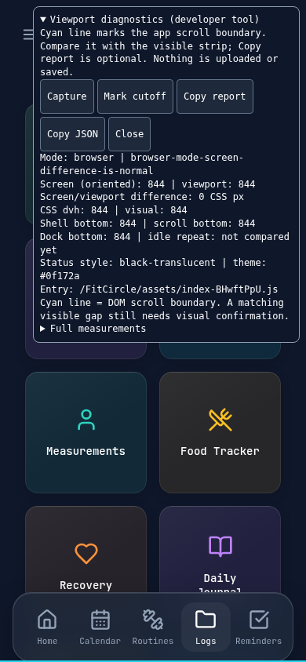

# Follow-up to PR #13: usable viewport and iOS system-region hypothesis

## Result and supported changes

The installed-app symptom is consistent with a system-controlled iOS region, but
**FitCircle's physical-device cause remains unconfirmed**. Earlier user testing
also reported Safari affected, so standalone exclusivity is not established.
A screen/viewport difference by itself is not proof of a bug.

This PR corrects an independently verified presentation mismatch: the manifest
specified green `theme_color`, HTML specified navy only in dark mode, and root
background painting was implicit. HTML now supplies navy unconditionally; manifest
and html/body/root/shell/header use the existing #0f172a navy consistently. No
viewport heights, safe-area additions, dock dimensions or scroll-padding changes
are shipped. Matching background colors **does not recover inaccessible pixels**.

The phone diagnostic is now accessible through an explicit developer gesture:
**Open Menu → tap Version 2.1.0 five times quickly**. It closes the sidebar before
measuring, shows screen/viewport/shell/scroll/dock values and a cyan main-boundary
line, and offers **Copy report**. No Mac, console or JSON collection is required.
Normal taps do nothing; the tool is absent/inactive in ordinary usage. Close fully
removes its panel, marker and listeners. There is no storage write or upload.

## WebKit evidence: primary versus secondary

Direct requests to all three primary Bugzilla pages were denied by the environment
network proxy (CONNECT 403). Their current status/comments could not be read here.
The user's quoted report and secondary reports below are evidence for hypotheses,
not primary-source verification or measurements of FitCircle.

| Report | Relevance and evidence limit |
| --- | --- |
| [301994](https://bugs.webkit.org/show_bug.cgi?id=301994) | The user quotes 874 screen height versus 812 inner/dvh/visual height and a 62px region. [TURN 394](https://github.com/enkeldesign/webb/issues/394) reports a similar iOS 26.5.2 landscape-first unreachable strip. [Sheetlog 215](https://github.com/thasarito/sheetlog/issues/215) reports fresh-install reproduction, a 59px strip, and no benefit from replacing dvh with fixed insets. These are other authors' reports, not confirmation on FitCircle. |
| [316008](https://bugs.webkit.org/show_bug.cgi?id=316008) | The user reports installation-time status-bar metadata behavior. [qui 2520](https://github.com/autobrr/qui/issues/2520) discusses installation-bound settings and a different risk with vh/lvh when the tag is absent. It proposes removing the tag, but that proposal is not a tested FitCircle fix or verified Apple guidance here. |
| [301172](https://bugs.webkit.org/show_bug.cgi?id=301172) | The user identifies fixed/sticky/safe-area defects. [nostter 2312](https://github.com/SnowCait/nostter/issues/2312) reports clipped installed-app navigation and cites it. Relevant to dock placement, but does not identify FitCircle's content boundary. |

Searching official WebKit commit numbers also matched unrelated canonical revision
numbers; those matches were discarded, not treated as fixes for these bugs.

## Metadata history and deployment verification

- `viewport-fit=cover` and `apple-mobile-web-app-status-bar-style=black-translucent`
  entered `client/index.html` in 4f3b26a (September 2025). The immediately preceding
  HTML lacked them. `apple-mobile-web-app-capable=yes` already existed.
- The static Pages migration dbb0d2c retained those tags and created the standalone
  Pages manifest with `/FitCircle/` identity/scope. These tags therefore predate
  all current static Pages releases. A missing-tag installation is less strongly
  supported for a recent Pages installation; an earlier origin is a different
  browser storage context and does not automatically transfer records.
- GitHub API reports Pages status `built`, successful deployment 7104185542 at
  SHA 8e56b6da50a4927dba4f5a22847215d548695d77, and successful workflow 38805967087.
  This is the main commit containing PR 13. The workflow artifact exists and is not
  expired (digest sha256:846a55e7fea74f720544c342c4bf3e9ccd7a29ecf43d69228bc66d0842b1c899).
- Live Pages HTTP requests were proxy-blocked. Downloading the deployment artifact
  was also blocked at its storage host. Actual deployed HTML/manifest/bundle bytes
  and a particular phone's SW-served shell could not be inspected here. A successful
  deployment record is not asserted as an independent live-content fetch.
- Current source and the locally built production output contain all required tags,
  the standalone manifest and the diagnostic asset. Existing offline/update tests
  pass. The diagnostic reports the actual entry script and DOM metadata of the
  running instance, allowing an older shell to be distinguished without clearing
  caches, unregistering workers or altering app storage.

The current head's status-bar tag remains unchanged. Reading it from DOM does not
prove which presentation settings iOS retained at installation. Existing installs
may retain older host configuration according to the supplied reports; no metadata
removal or reinstall workaround is shipped without physical evidence.

## Isolated layout experiments

Run a production preview, then:

```sh
PLAYWRIGHT_CHROMIUM_EXECUTABLE_PATH=/usr/bin/chromium \
  node scripts/compare-viewport-strategies.mjs /tmp/strategies.json
```

The executable override is optional with bundled Chromium. `REVIEW_BASE_URL`
overrides the preview base. Every strategy uses a fresh context and synthetic
records; CSS overrides exist only in that test page. Source production CSS is not
rewritten by the runner. Portrait 390×844; simulated app-safe 59/34; actual Chromium
environment insets 0. Standalone signals and missing-tag HTML are simulated; this
cannot emulate an iOS installation or host surface.

| Strategy / hypothesis | Shell / main bottom | Tile intersection bottom | Results and risk |
| --- | --- | --- | --- |
| A: existing 100dvh | 844 / 844 | 844 | Baseline passes header, dock, both final cards, modal wheel lock and route reset. |
| B: fixed inset 0, auto height | 844 / 844 | 844 | No additional area in this engine. Does not demonstrate recovery of an iOS host region. |
| C: document scrolling | 1181 / 1181 (document content) | 844 | Cards, sticky header, dock and Radix wheel lock pass this smoke check; route change leaves scrollY 169. Existing route-reset logic targets main, so this introduces a confirmed navigation regression and needs architectural changes. Not shipped. |
| D: 100vh | 844 / 844 | 844 | No recovery; browser-chrome/keyboard risks need native testing. |
| D: 100svh | 844 / 844 | 844 | No recovery; intentionally small viewport is not a universal physical screen source. |
| D: 100lvh | 844 / 844 | 844 | No recovery; may exceed browser-mode usable area. |
| D: supported `-webkit-fill-available` | 844 / 844 | 844 | Supported here but no benefit; cannot establish host-pixel reachability. |
| E: standalone signal / current metadata | 844 / 844 | 844 | Same Chromium bounds; host mode itself is not emulated. |
| E: standalone signal / status tag absent | 844 / 844 | 844 | No Chromium difference; installation-time behavior cannot be tested this way. Removing the tag globally is unsupported by this result. |

All nine strategies had a stationary dock, final Logs/Routines clearance, header
control at y 81, sheet close at y 67, and background wheel locking in this smoke run.
The full [measurement summary](strategy-results.json) includes actual rects and
viewport units. Strategy A is retained: no alternative recovered any area in the
available engine, and document scrolling broke existing navigation. Keyboard and
overlay recovery are validated on the retained production architecture by the
full regression suite, not claimed across all experimental variants.

The presentation correction leaves shell/main at 0→844 / 131→844 and dock at 733→844
in this simulation. Theme changes from conditional HTML navy / manifest green to
unconditional matching navy; header and capsule sizes are unchanged. This is not a
before/after measurement of the physical gap disappearing.

## Screen/viewport interpretation

`analyzeViewportGap` compares screen CSS dimensions with browser-exposed dimensions
without applying their difference to any layout style. Orientation is derived from
screen orientation or the legacy orientation angle, not blindly from a keyboard-
shrunken viewport. DPR is recorded for screenshot interpretation, not multiplied
into CSS heights. Unknown orientation yields no system-region inference.

A possible system region is reported only for standalone, idle, unit-scale,
unpanned geometry whose inner/client/dvh/visual/shell/main bounds agree while the
orientation-normalized screen height is larger. It remains conditional on the
visible strip matching that difference and comparison with Safari. Matching idle
samples separated by at least 500ms are reported as stable; this is not continuous
physical-device verification. Browser mode, editing/keyboard, zoom/panning and
actual short-scrollport cases have separate results. Current/previous samples
exist only in memory until the tool closes.

If the gap is outside WebKit's rendering surface, increasing CSS height creates
content in unreachable pixels; it cannot make iOS expose that area. CSS safe-area
insets describe padding within the viewport, not permission to draw beyond it.
Apple Fitness is a native app and does not necessarily share the PWA host surface.
The best supported behavior is to keep every control in the usable web viewport,
maintain content access, match the background, and avoid false physical-fullscreen
claims or oversized compensation layers.

## Simple physical check (no developer workflow)

After reviewed deployment, allow the normal app update, close and relaunch FitCircle
from Home Screen, open Logs and scroll. Check whether content continues below the
dock to the actual bottom, then bring the last tile above it. Open/close calculator,
switch tabs and rotate if supported. No site-data clearing or reinstall is needed.

If the strip persists: **Open Menu → tap Version five times**. Compare the cyan
line with the cutoff. **Copy report** is one tap if sharing results is convenient;
a screenshot or simple visual observation is enough for the next check. Close
returns to normal usage. Safari can use the same gesture for an easy comparison.
Full JSON and manual cutoff marking remain optional; a Mac is not required.

## Reinstall is not the normal next step

No app removal is recommended by this PR. If an installation-time experiment later
becomes necessary, do not delete the installed app until this plan is complete:

1. In the existing installed app, Settings → Download Complete Backup. Confirm the
   fresh JSON exists outside the app in Files; keep a second personal copy.
2. On an independent device or fresh browser profile with no existing FitCircle
   records, restore that file and verify representative workouts, logs, goals and
   custom foods. Do not assume Safari and Home Screen share the same storage.
3. Keep the original installation and backup until restoration has been verified.
   Existing automated backup/IndexedDB tests pass, but they do not verify this
   person's actual current backup file.
4. Only then, with a deliberate separate decision to test installation metadata,
   consider removal/reinstallation. Removal may delete the app's local container.
5. Restore the verified file in the new instance and compare records before
   discarding any backups. Reinstallation is not guaranteed to solve a system bug;
   other reports describe fresh-install reproduction too.

## Automated results and limits

TypeScript passes; 36 unit tests pass; production build passes (existing bundle-size
warning); 42 Chromium Playwright tests pass. Seven new unit tests distinguish
system-candidate, browser, focus/keyboard/zoom, actual DOM clip, orientation and
stable-sample cases. Phone tests cover controlled activation from all five menus,
ordinary-tap inactivity, dismissal/marker cleanup, unchanged storage and navy
metadata in both light/dark modes. Existing viewport, final-card, header, keyboard,
modal, navigation, backup and offline tests remain intact. The diagnostic test's
summary selector now identifies its root summary separately from Full measurements;
no behavioral assertion was removed.

Physical iPhone/WebKit rendering and installation-bound host settings are not
verified. Primary Bugzilla/live Pages/artifact fetches were blocked as recorded
above. No permanent iPhone gap fix is claimed. This PR supplies an independently
valid configuration correction, tested experiments and a usable phone-only check,
rather than another guessed viewport offset or documentation-only change.

Phone-only interface capture (Chromium simulation; not an iPhone runtime report):


