# Appearance Phase 1 — foundation, Dark preserved

## Scope and baseline

Based on main `67235ff` (PR #71 merge; includes audited `04a0226`). Phase 1 only: valid semantic color mappings, palette foundations, a centralized preference controller, and validated backup integration. No Settings selector, page-wide Light conversion, new theme library, fitness-data migration, calculation change, metadata change or service-worker change.

Before any styling edits, captured 11 Chromium views at 390×844 with synthetic data and a fixed local date. Baselines and sampled computed colors live in [`tests/browser/appearance-baseline.spec.ts-snapshots`](../../../tests/browser/appearance-baseline.spec.ts-snapshots). The random quote is seeded to the exact quote in the original capture so screenshots are deterministic. Nutrition Details is inline following PR #71; no removed modal or Weekly Overview was recreated.

The regression uses `maxDiffPixels: 0` and `threshold: 0`; original baseline images/JSON are not regenerated to accept styling changes. After captures below match the original PNG bytes.

## Changed file groups

| Files | Purpose |
| --- | --- |
| `tailwind.config.ts`, `client/src/styles/appearance.css` | Valid HSL mappings and foundational semantic palettes. |
| `client/src/lib/appearance.ts`, `client/src/main.tsx` | Central controller and production Dark gate after restore recovery. |
| `client/src/index.css`, `client/src/components/ui/{button,card,dialog,sheet}.tsx` | Minimal compatibility corrections for previously invalid styles; no page conversions. |
| `client/src/lib/{backup,storage-registry}.ts` | One registered preference and strict restore validation. |
| `tests/appearance.test.ts`, browser appearance tests/snapshots, regression tsconfig, complete-storage fixture | Preference, backup, token, release-gate and Dark visual regression coverage. |
| Storage inventory and this review folder | Persistence documentation and before/after evidence. |

## Token correction and compatibility

Tailwind now wraps HSL channel variables with `hsl(var(--token) / <alpha-value>)`, including semantic surfaces, text, controls, charts and sidebar aliases. This fixes previously invalid colors and supports opacity modifiers. No layout/radius/animation mappings change.

Existing `index.css` and `glass.css` remain the Dark palette/material baseline. New `appearance.css` adds surface, elevated/secondary surface, text, border/separator, control, navigation, overlay, progress-track, focus, accent and on-accent roles and a development-only Light palette. Existing glass variables remain the shared shadow/translucency roles, with Light overrides and opaque/reduced-transparency fallbacks. Primary remains neutral, not green. Existing workout identifiers, CSS gradients, ring mappings and page styling remain intact.

Activating formerly invalid tokens could otherwise turn neutral buttons white/dark-red, tint inherited Card text, add blocks behind close icons and globally change default borders. Minimal compatibility changes preserve transparent/inherited default and destructive buttons, inherited Card text, currentColor default borders and unfilled close controls. Explicit colored button classes remain in force. Existing field focus/scroll geometry is retained. Later phases can deliberately adopt semantic roles in shared components/pages.

## Controller and release gate

`appearance.ts` exposes strict validation, pure resolution and a small controller with stable snapshots, subscription, explicit save and cleanup. It separates `preference`, `resolved` and `applied`. Missing/invalid preferences resolve Dark regardless of the device; System uses matchMedia. Media changes, cross-tab storage changes and pageshow refresh the state. Successful same-tab saves publish directly; unchanged events do not notify subscribers. There are no React subscriptions or app rerenders in Phase 1.

The production call pins applied appearance to Dark even if a backup contains Light/System. Only `import.meta.env.DEV` permits applying the resolved preview. No URL flag, public route, Settings control, global debug API or production environment override enables Light. Browser tests inject the controller into an isolated test document; that harness is not shipped.

Internal preview: run `npm run dev`, use the browser console to explicitly set `localStorage.setItem('fitcircle_appearance', 'light')` (or `'system'`), then reload. This previews tokens, not completed page conversions. Remove that one key to return to the default. Do not deploy the development server as production.

## Persistence and backup safety

One new scalar key: `fitcircle_appearance`, raw `dark`, `light` or `system`. No default writes, migration or automatic repair. Malformed original bytes remain untouched. Read failures fall back to Dark; write failures return `ok: false` and leave the saved/selected preference unchanged. A later explicit successful save can replace an invalid preference.

The storage registry includes the key as a backed-up setting. Backup validation checks its enum **before** the generic scalar shortcut. Current v2 export/import preserves all unrelated strings and records; the backup version is unchanged. Old backups omit it and neither create a preference nor reset an existing one. Invalid values in a restore plan/file reject the restore before writes. Export follows existing byte-preservation behavior: it preserves a malformed raw value, while restoring that malformed preference is rejected rather than silently repaired. Interrupted-restore recovery still runs before controller initialization.

## Rendered Dark evidence

| Element | Baseline / after |
| --- | --- |
| `body` — background | `rgb(15, 23, 42)` |
| `body` — color | `rgb(248, 250, 252)` |
| `.dock-nav` — background | `rgba(30, 41, 59, 0.65)` |
| `.dock-tab[aria-current="page"]` — background | `rgba(148, 163, 184, 0.1)` |
| `.glass-dialog` — background | `rgba(15, 23, 42, 0.96)` |
| `input` — background | `rgba(30, 41, 59, 0.88)` |
| `input` — border | `rgba(203, 213, 225, 0.2)` |

## Before / after screenshots

### home-and-dock

Before: 

After: 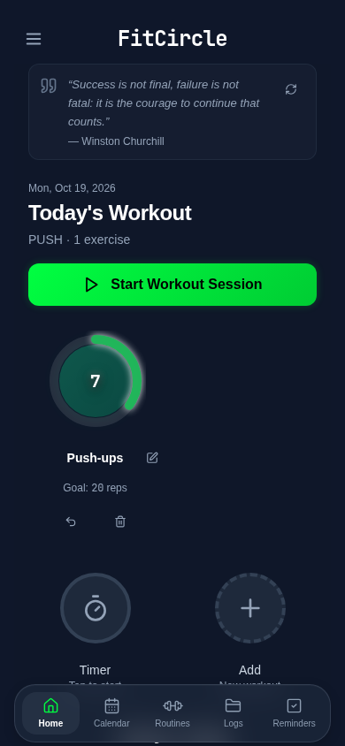

### routines-collapsed

Before: 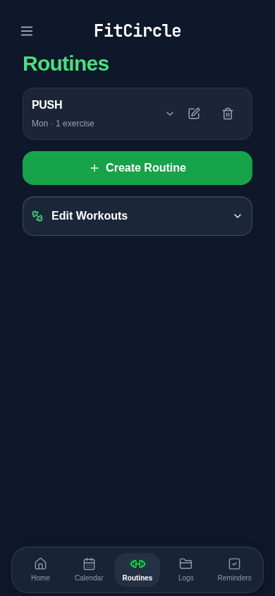

After: 

### routines-expanded

Before: 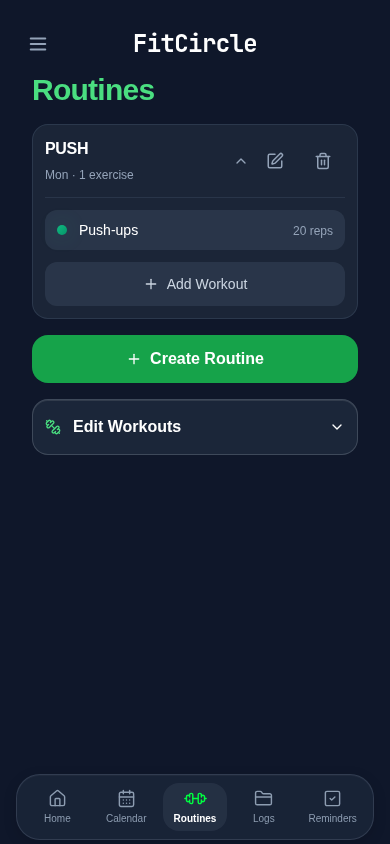

After: 

### calendar

Before: 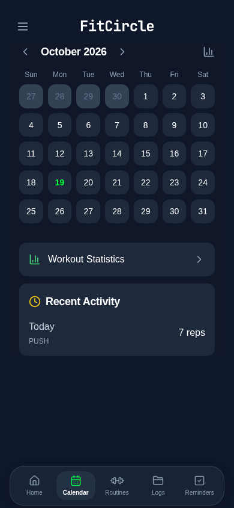

After: 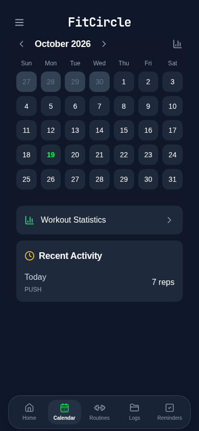

### wellness

Before: 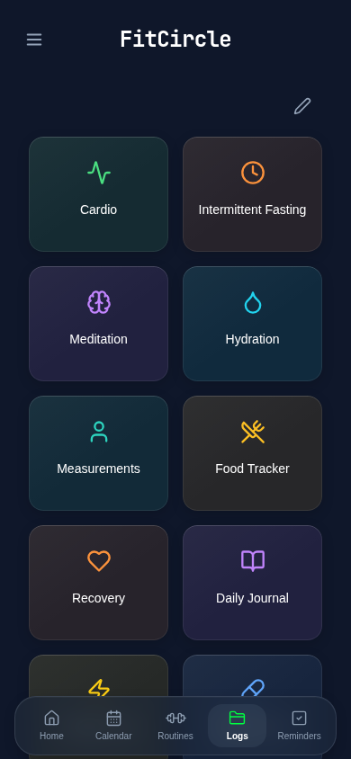

After: 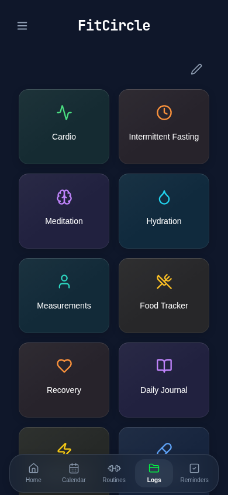

### food-tracker

Before: 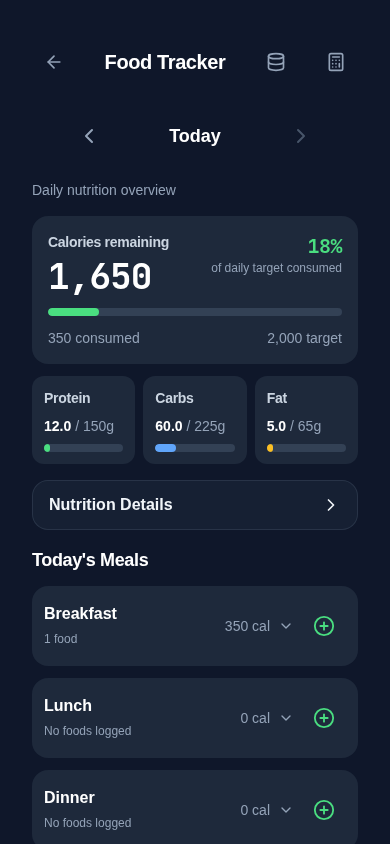

After: 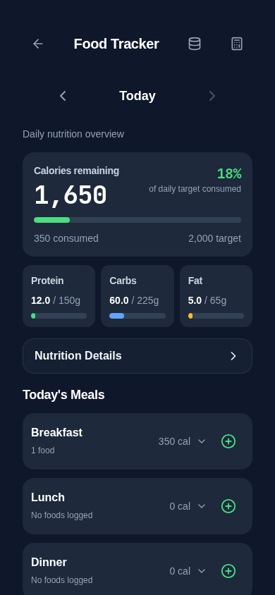

### nutrition-details-inline

Before: 

After: 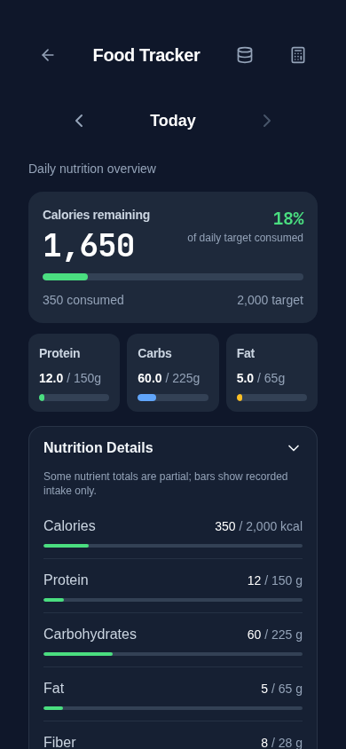

### settings

Before: 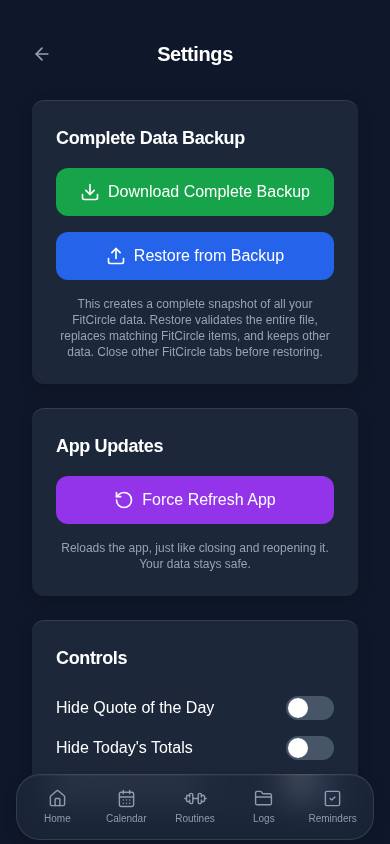

After: 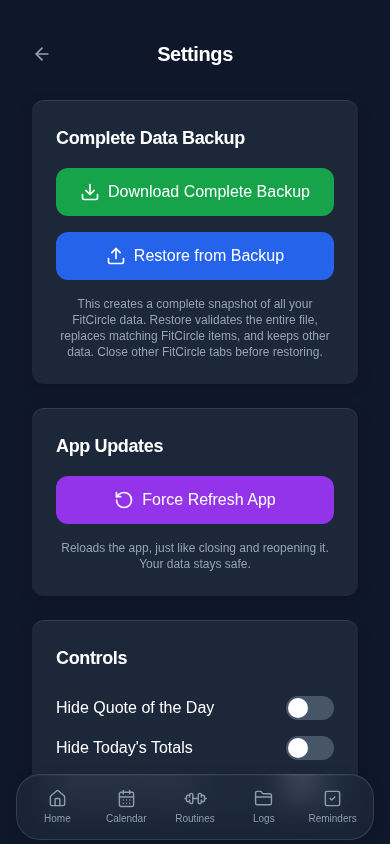

### workout-editor

Before: 

After: 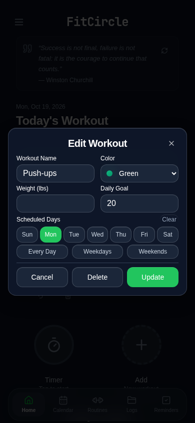

### hydration

Before: 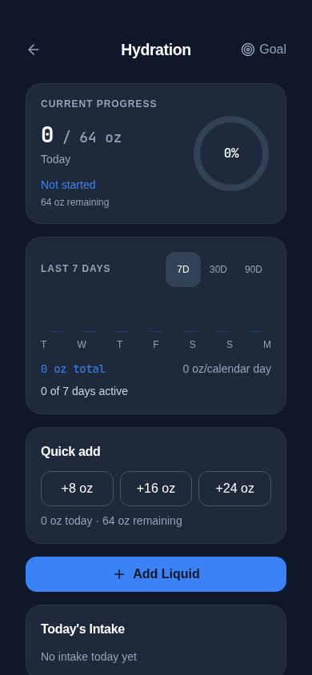

After: 

### hydration-goal

Before: 

After: 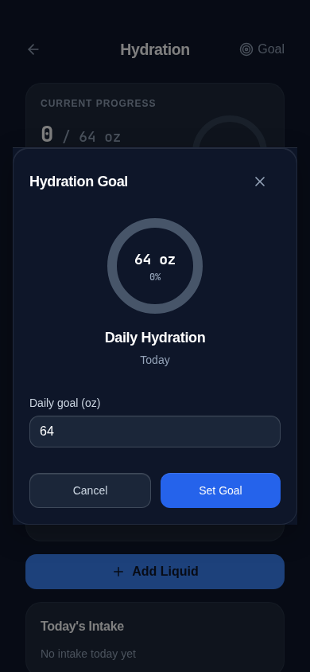

## Verification

- `npm run check`: passed.
- `npx tsc --noEmit -p tests/tsconfig.regressions.json`: passed.
- `npm test`: **291 passed, 0 failed**.
- `npm run audit:storage`: **160 call sites, 0 errors**.
- `npm run build`: passed.
- New appearance browser coverage: **11 passed**, including all 11 byte-identical Dark captures and exact sampled-color snapshots.
- Final full Playwright run: **274 passed, 1 failed** in the previously documented barcode `automatic scan caching failure...` test. It failed before Add Entry opened with `Failed to fetch`; the complete Food Tracker spec then passed **21/21** on rerun.
- An earlier full run also had **274 passed, 1 failed**, in the existing worker-update recovered-HTML polling check. All update tests passed **6/6** independently and in the final full run.
- No existing assertions/timeouts/retry settings were relaxed; no barcode or service-worker logic changed. The barcode flake was already recorded in [the modal-field review](../modal-fields/README.md). Physical iPhone testing remains deferred.

Coverage includes preference validation/defaults, live System changes, explicit overrides, controller recreation/reload, notifications/cleanup, same/cross-tab updates, production release gating, read/write failures, valid semantic/opacity CSS in both palettes, root-inherited portal colors, complete v2 backup round trips, old-backup compatibility and byte preservation.

## Limitations and next approval

- Light is a palette preview only. Explicit page colors and specialized visualization colors intentionally remain for Phases 2–4.
- Early HTML bootstrap, dynamic theme-color, native color-scheme, Settings UI and PWA appearance validation remain Phase 5. No claim of physical iPhone verification or initial-flash prevention is made here.
- Screenshots use Chromium/Linux and fixed synthetic data. Real Safari/PWA launch/status-bar/keyboard behavior requires physical-device checks later.
- Approval is required before Phase 2. Review the preserved Dark baseline, the internal Light palette direction, and the compatibility treatment for previously ineffective semantic styles. No Phase 2 work has started.
