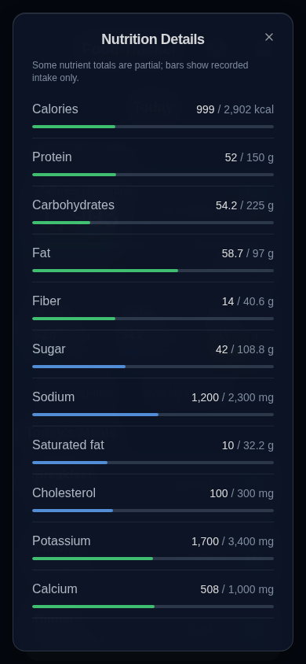

# Automatic Total Sugar tracking reference

Nutrition Details now displays `Sugar intake / reference g` with the existing thin progress bar. The reference is calculated as `(confirmed daily calories × 0.15) / 4`, an app-defined total-sugar tracking convention, not an official RDA, FDA Daily Value, or added-sugar allowance. This implementation does not claim to verify another app's current policy.

With 2,902 kcal/day, the reference is 108.825 g/day (approximately 109), displayed as 108.8 g using the modal's existing one-decimal formatting. Calculations retain full precision. At 3,000 kcal/day it becomes 112.5 g. The confirmed calorie target comes from the same saved Calculator targets already supplied to Food Tracker; there is no illustrative 2,000-kcal fallback. Invalid or unavailable calorie targets give intake only, without a fabricated percentage.

The bar automatically follows existing same-tab calorie-target notifications and reloads. Actual intake is uncapped while the visual fill stops at 100%. No over-target warnings, labels, settings, prompts, new storage fields or keys are introduced. The proposed personal-target editor was removed in response to the user's final clarification.

The existing `sugar` field remains total sugar, including naturally occurring and added sugars. Serving scaling, nutrient completeness, historical entries, goals, storage formats, JSON backup validation and import/export behavior are unchanged. The calculation is read-only; it does not save a Sugar target or overwrite existing goal metadata. The existing codebase has no supported personal Sugar target setting, and this change adds none.

Reference semantics remain explicit (`reference` / `app-convention`) rather than claiming a personalized recommended intake. The source explanation is in the existing collapsed Reference information, not the nutrient row. Cholesterol, vitamin A and other nutrient references are unchanged.

## Validation

Application and regression-test TypeScript passed; all 281 unit tests passed; storage audit passed (158 call sites, 0 errors); production build passed. Focused Nutrition Details/Food Tracker browser run: 28 passed and one existing automatic-scan-caching test failed waiting for Add Entry. All eight Nutrition Details cases passed. Final full browser suite: 241 passed, 1 failed in that same existing automatic-scan-caching case waiting for Add Entry. It passed independently on rerun (1/1). All eight Nutrition Details cases and complete backup regressions passed. No barcode code, test timing or retries were changed.

All data used is synthetic. No physical iPhone Safari/PWA verification is claimed. On iPhone, open Nutrition Details and check the Sugar amount and thin bar, change the confirmed Calculator calorie target and reopen Nutrition Details, then verify the reference updates without any Sugar settings prompt. Check scrolling and close-button access with large text.
