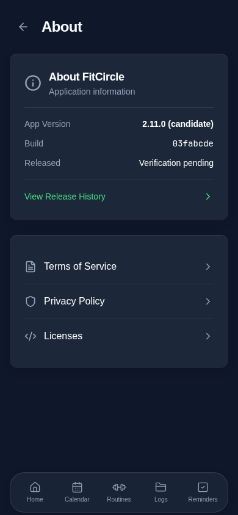
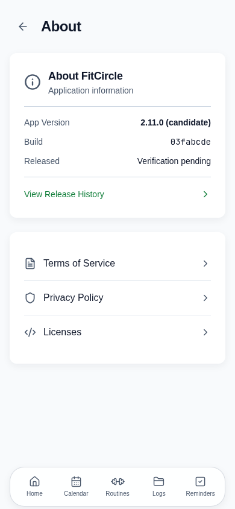
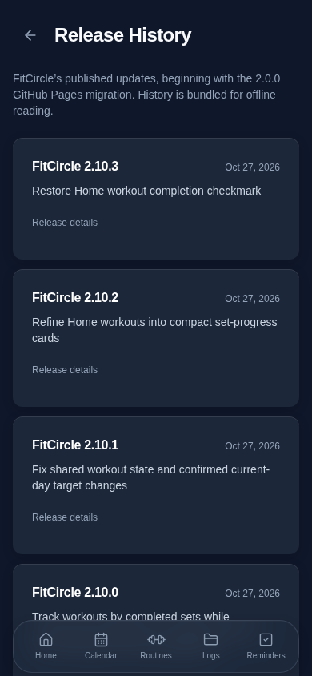
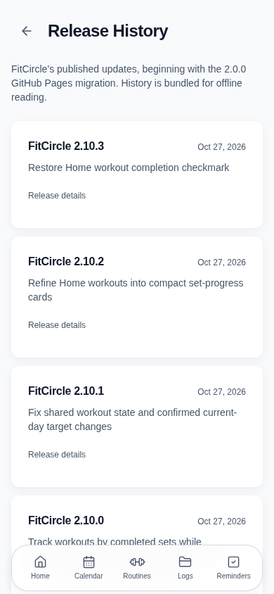

# Automatic versioning, release history and build display

Implementation, focused validation and review delivery are complete in this PR. **Production automation is not activated.** No registry branch, repository variable, environment protection, production tag, GitHub Release, merge or deployment was created by this work. The initial four implementation commits separate registry utilities, workflow integration, build metadata and UI; the final commit contains tests, safeguards and documentation.

## Reconciliation and first candidate

The approved baseline and original ledger are unchanged: 2.0.0 at the October 15, 2026 static-PWA migration, and 2.10.3 through #94. PR #95 merged at `8ba8a8f9670f72dea25ec6ae8a8b212ead9ac8b4` and subsequently published successfully at **2026-10-27 15:36:13 UTC**, deployment **7362901786**, run **40531878315**. [Deployment](latest-deployment.json) · [Status evidence](latest-statuses.json).

#95 is explicitly reconciled as `release:none`: its documentation, tests and unused foundations added no distributed capability. That decision is recorded in `release/activation.json`, not guessed from its title. It remains a historical publication at 2.10.3, with unknown historical payload digest explicitly null; no artifact hashes are fabricated. Initialization reads live successful publication evidence and reconciles any newer classified merges rather than blindly copying the old current pointer.

[Read-only dry-run output](dry-run.json): base 2.10.3 at #95, plus this explicitly proposed **minor** capability → **2.11.0**. This is the proposed first automatically managed release **if the registry/settings are prepared before this PR is merged**. The actual production planner re-evaluates current successful history and merged PR labels under the production lock. New intervening publications or a staged merge with automation disabled can change that first automatic number; 2.11.0 is not hardcoded.

## Registry and transaction

`release-ledger` is an orphan repository branch with `registry.json` and immutable `receipts/<buildId>.json` files. Approved history seeds an append-only record chain. Records include version, full SHA, run ID, Pages deployment ID, exact success-status timestamp, PR classifications/summaries, previous record identity and payload digest. Historical unknown artifact/build identities remain null. Every registry write verifies the prior record prefix is unchanged and makes a Git commit parented to the observed ref. Updating the ref uses `force:false`; concurrent sibling writers cannot both succeed. Branch/ruleset protections must complement these application-level checks.

`scripts/release/model.ts` holds pure planning/reservation/reconciliation rules. `github.ts` wraps read APIs and non-fast-forward-protected writes. `cli.ts` supplies classification, read-only dry-run, initialize, plan, digest, reserve, record and reconcile commands.

Production sequence when `FITCIRCLE_RELEASES_ENABLED=true`:

1. The main push acquires workflow-wide `fitcircle-production-release` concurrency with cancellation disabled. The same group protects manual registry operations. PR workflows remain cancellable and read-only.
2. Planner reads the current registry, refuses unresolved reservations or unrecorded successful publications, and skips commits already published or older than the published commit. It walks first-parent ancestry, resolves merged main PRs through the API and reads exactly one explicit label per PR. Direct/unassociated commits fail closed; use a classified PR instead. The only historical exception is #95's reviewed none classification.
3. Highest impact wins once. Major planning requires a configured required-reviewer environment, and a protected `release-major-approval` job gates reservation. None-only ranges do not publish another application build or consume a version; their PRs are included in the next meaningful release range.
4. Candidate metadata is generated before Vite builds once. All four browser shards and Pages use the same `tested-site` artifact. The existing TypeScript, unit, storage audit, production build, browser checks, pinned browser/fonts and aggregate `build` gate remain.
5. The finished `dist` tree is deterministically hashed by sorted relative path and bytes, including generated metadata, SW and history. It is verified again after downloading the tested artifact. Unlike the earlier proposal, no digest is embedded inside the payload it hashes: **buildId = full SHA + run ID + run attempt** binds embedded metadata to the post-build digest. This avoids a self-referential hash or a post-test rebuild. The small candidate artifact is retained 90 days.
6. A trusted contents-write job reserves that exact candidate/digest in the registry before deployment. A different pending candidate or changed base is rejected.
7. The existing Pages deploy job retains its environment and pages/id-token permissions. A separate post-deploy job reads the environment's successful status after the deploy job completes, matches SHA/run/environment, and appends the release/receipt atomically. No optimistic timestamps or pre-publication tags are created.
8. If recording fails, the reservation persists and blocks subsequent advancement. An approved reconciliation matches the actual GitHub status to the reserved candidate and writes the same version, never a replacement version. If the deploy job/Deploy step succeeded but its status is temporarily unavailable, reconciliation refuses to clear the reservation. Failed/cancelled completed runs with no successful deployment can clear the reservation; the next candidate reuses the unconsumed increment. Incomplete/ambiguous evidence blocks for investigation.

Repeated recording is idempotent. A repeated source commit is skipped. Rollbacks should be reviewed revert PRs with a new patch version; no force push or history deletion. GitHub may reorder/replace queued pending runs even with cancellation disabled; ancestry checks skip old runs and the newer candidate includes all unpublished merged PRs.

This implementation has been locally tested/linted, **not exercised as a live GitHub deployment transaction**. The workflows remain gated for owner setup and approval.

## Classification and permissions

`release-classification.yml` runs on PR open/synchronize/reopen/label/unlabel/edit events. It reads live labels, rejects missing/unknown/conflicting classifications, and executes only trusted base checkout code with read permissions. It does not use `pull_request_target`. Required label: one of `release:major`, `release:minor`, `release:patch`, `release:none`. The four classification labels were created on the repository; this PR uses `release:minor`. Creating labels does not enable release publishing.

`pages.yml` adds read permissions for source/PR/deployment evidence during planning. Registry write permissions exist only in trusted main reservation/recording jobs. PR code receives no registry or Pages write permissions. `release-admin.yml` is main-only, serialized, protected by `release-admin`, and supports initialize/reconcile; initialization refuses an existing ref. Scripts also check required reviewer configuration rather than treating an automatically created unprotected environment as approval. No secrets or external deployment service are introduced.

**Owner configuration required:** branch-protection and workflow-permission reads returned 403. Existing `github-pages` protection exposes a branch policy but no required reviewers. Do not assume merge enforcement or major approval is already configured.

1. Create labels `release:major`, `release:minor`, `release:patch`, `release:none` (if not already created for this PR). Require the `release-classification` status alongside the existing `build` and any existing backup checks on main. Preserve all current required checks. Require PRs; disallow unclassified direct pushes. Apply rules to admins where appropriate.
2. Create environments **release-major-approval** and **release-admin**, restricted to main, with the owner as a required reviewer. Prevent self-review if the owner wants a second approver. Do not rely on GitHub's automatic environment creation. Retain `github-pages` environment/base-path settings.
3. Permit the trusted main jobs' `GITHUB_TOKEN` to write contents. Protect `release-ledger` against force pushes/deletion and unauthorized writers. Configure ruleset restrictions so the trusted GitHub Actions writer can append without allowing general developers to rewrite it; if the repository's plan/rules cannot grant that safely, stop activation and review the smallest authorized writer alternative. Do not broadly relax main protections.
4. Keep repository variable **FITCIRCLE_RELEASES_ENABLED unset/false** until initialization, permissions, classification and recovery procedures have been reviewed. This PR does not set it.

### Recommended activation order (owner action after approval)

To make this PR itself the first managed 2.11.0 publication:

- Review the exact PR revision and set its `release:minor` label. Configure the environments and permissions above.
- With the reviewed source checked out and a current `origin/main`, the owner can run the read-only command `npx tsx scripts/release/cli.ts dry-run` with authenticated `gh`.
- After reviewing that output, the owner can explicitly initialize using `RELEASE_ADMIN_APPROVED=true npx tsx scripts/release/cli.ts initialize` from that reviewed checkout. This creates the release-ledger branch only; it does not deploy. The command requires the configured reviewer environment and refuses an existing registry. The owner's invocation is the explicit initial administrative approval; subsequent operations use the protected workflow after it reaches main.
- Apply ledger branch protections and verify the current record/absence of pending state. Set `FITCIRCLE_RELEASES_ENABLED=true`. The old main workflow does not consume this variable; automatic release behavior starts only when the reviewed workflow is merged.
- Owner merges this PR. Full CI plans from the actual registry and labels, then publishes/records only on success. Inspect the candidate output and final receipt before considering activation validated.

Alternative: merge with the gate off first. Existing Pages deployment remains operational, but that build truthfully displays **Development/Not published** because it was not generated as a numbered candidate. Initialize/reconcile that successful publication afterward, then enable automation for a new classified PR. In that staged path this capability may already be reconstructed as 2.11.0, so the first automatic patch would be 2.11.1. Re-run the dry run; never force 2.11.0 onto a different already-published build. This is why pre-merge initialization is recommended when an unversioned interim UI is undesirable.

## Application metadata and UI

`application-version.ts` is the shared runtime identity/receipt contract; `build-info.ts` binds the generated immutable object and shares its resolution promise. Vite emits the same object in the JS bundle and `build-info.json`, replacing package-derived application version injection. `package.json` remains a package identifier and is not a synchronized release counter.

- Development servers always say Development, even if a candidate file exists for a local build.
- Production candidates show their planned version and `(candidate)` until their exact receipt is available. Missing/unverified dates say Verification pending.
- A receipt must match the loaded build's full SHA, version and buildId and contain a valid digest, deployment ID, date and changes. It cannot make an older loaded build display a newer version.
- About displays version, short SHA, released date, existing legal/license destinations, and View Release History. History uses the existing page/Back conventions and global scrolling/safe areas, not a new modal.
- Historical releases are bundled for offline reading. A verified current receipt adds its own entry. Technical commit/PR details are expandable; they do not dominate the list.
- Receipts are read from one immutable public GitHub raw URL per build. Verified responses can be retained in **CacheStorage `fitcircle-release-receipts-v1`**, registered as public metadata with `backup:false`. This is separate from all fitness localStorage and JSON backup keys. Restoring a fitness backup cannot downgrade metadata bundled into JS.
- No user records, appearance preferences, IndexedDB schemas, fitness calculations or backup formats change.

## PWA behavior and limits

The existing SW, manifest, route-recovery document, cache hash generation, registration and Force Refresh logic are unchanged. Build metadata/history are part of the precached production payload. An old loaded build continues to use its own embedded identity; receipt lookup cannot substitute the online latest release. Older pre-feature installations still show whatever version code they previously contained until the new build loads—this cannot be retroactively changed offline.

An offline build can read bundled history and a previously verified cached receipt. Without a receipt it remains honestly pending. Online events retry unavailable receipt resolution without reloads. A browser that evicts CacheStorage may lose the verified date until reconnection; it does not lose the embedded version/SHA. No automatic reload, cache clearing or service-worker unregistration is added. An update indicator is deliberately deferred: the existing Force Refresh remains the explicit user action, avoiding any workout/draft interruption.

## Screenshots

Synthetic local production candidate **2.11.0**, not a real publication. The published example uses a deterministic mocked receipt; its date is not a claim of live release success.

| About Dark | About Light |
| --- | --- |
|  |  |

| History Dark | History Light |
| --- | --- |
|  |  |

[Published-state UI with synthetic matching receipt](published-about-synthetic.png). Captured at 390×844; 320px width and long-history reachability checked automatically. Physical iPhone checks remain required.

## Validation

- `npx tsx --test tests/automatic-release.test.ts tests/release-versioning.test.ts`: **14 passed**. SemVer, classification, major guard, none, failed/cancelled retry, idempotence, stale/pending rejection, compare-and-swap competition, append-only records, recording-failure recovery, payload digest, build identity, offline receipt caching and backup exclusion.
- `npm run check`: passed.
- `npx tsc --noEmit -p tests/tsconfig.regressions.json`: passed.
- `npm run audit:storage`: **164 call sites, zero errors**. The initial run correctly required registration of the new metadata-only CacheStorage source; registration was added without changing backup keys.
- `npm run build`: passed for ordinary unversioned build and a synthetic production candidate (existing bundle-size/Browserslist warnings).
- Focused `release-versioning.spec.ts`: **5 passed** (Dark/Light, About/history/back, narrow layout, unchanged workout records, offline refresh/history, Force Refresh offline handling, development labeling, matching receipt and offline persistence).
- Existing Phase 2 dark core appearance scenario: **1 passed**; only the sidebar version-text baseline changed. Unrelated generated galleries were discarded.
- Existing five-tap version diagnostics regression: **1 passed**, preserving the developer gesture and storage behavior.
- `actionlint` on all three affected workflows: passed. No hosted execution of the new release workflow claimed.
- Read-only dry run reconciled #95 and proposed 2.11.0. No full local regression suite; GitHub Actions remains responsible for complete CI.

## Recovery and rollback

- **Validation failure before reservation:** fix in a classified PR; no official version consumed.
- **Failed/cancelled deployment after reservation:** run protected Release registry administration → reconcile after the failed run is terminal. It checks GitHub deployment/run evidence; only then can a subsequent push re-plan without a skipped version.
- **Successful deployment, failed record write:** do not disable the gate to push past it. Restore write permissions/API availability, run reconcile. It records the reserved version and exact successful timestamp once; no rebuild or new version. If evidence is incomplete or a Deploy step succeeded without a readable receipt, stop and inspect the linked run/deployment; retain the reservation.
- **Competing registry writer:** the non-fast-forward update fails; re-read, investigate and reconcile. Never force-push the branch. The next production workflow refuses unresolved state.
- **Rollback of application feature:** use a classified revert PR, retaining the registry and receipt history. Versions advance normally. Fitness data is untouched.
- **Emergency automation rollback:** with owner approval set the gate false and restore the last reviewed Pages workflow via PR. Retain the registry, pending record and public receipts. Older application bundles and fitness data remain valid. Reconcile any manual/fallback publication before re-enabling; the planner intentionally detects unrecorded publications and refuses to invent metadata.

Manual iPhone checklist: Safari and installed PWA; online/offline launch; older open tab across deployment; About version/date after reconnect; long history and Back at 320px; Force Refresh with no active workout; preserve active timer/unsaved journal while opening metadata; confirm all existing workout/food records; check downloaded/restored fitness backup does not alter application identity. No routine reinstall, unregister or storage clearing.

## Completion boundary

Phase 2 implementation, Phase 3 focused validation, and Phase 4 PR/review deliverables are complete together. The goal of a reviewable, automatically versioned release pipeline and build-bound version/history UI is implemented. **Operational activation and live end-to-end deployment verification remain owner-gated and have not been performed.** Owner settings above and successful GitHub CI must be confirmed before activation/merge; this is not a claim that production currently uses the new system.
