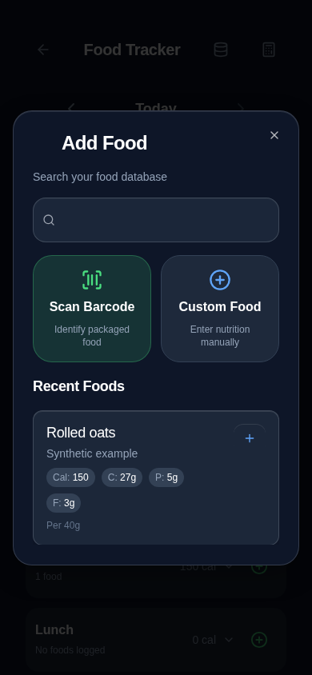
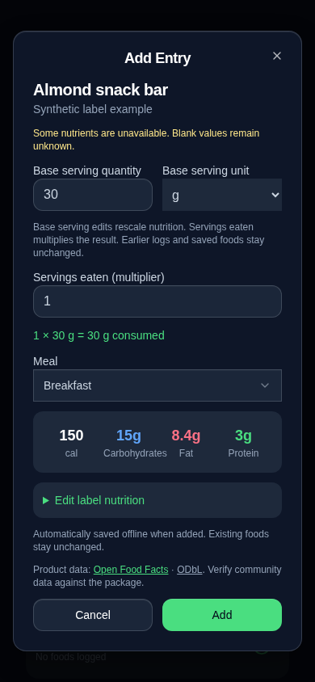
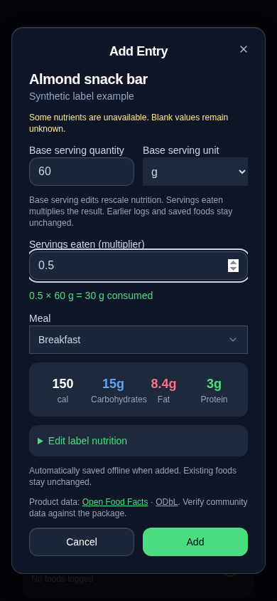

# Barcode serving and Add Food follow-up

This follows merged PR #53. The Food Tracker 2.0 implementation remains in place; this change replaces its two-stage scan/review flow with the existing Add Entry destination. Earlier review documents describe the previous flow and remain historical records.

## Behavior changes

- **Label servings:** The v3 normalizer previously replaced the package's serving size with the aggregated nutrition basis (100 g/ml). It now keeps those facts separate, requests numeric serving metadata, selects a usable declared serving, and scales all available nutrients from the density to that serving. For example, 500 kcal/100 g and a 30 g label serving become 150 kcal per 30 g. Explicit per-serving products retain their serving basis.
- **Serving adjustments:** Add Entry exposes both the base quantity/unit and the independent consumed multiplier. Changing 30 g to 60 g doubles known base nutrients; choosing 0.5 servings then records consumption equivalent to the original 30 g. Calculations use a stable anchor, not repeatedly rounded intermediate values. Label nutrient corrections are available in a collapsed section on this same screen; missing core values expand it automatically and block logging until completed.
- **Unit conversions:** g/oz use their defined conversion. Weight, volume, pieces and household units are not interchangeable without a user-supplied equivalence. For example, two pieces at 30 g each can be scaled from a known gram-based product. Unknown serving weights, ambiguous multipacks and missing nutrition are never guessed. When no usable package serving is returned, the known API basis remains visible and editable, with an explanation.
- **One entry screen:** Successful local or external barcode lookup opens Add Entry directly. The intermediate ProductReview component is removed. Camera startup, stream cleanup, permission fallback and lookup cancellation remain intact. No input is automatically focused on opening.
- **Automatic offline products:** No save checkbox remains. Adding a valid scanned food automatically saves a new product in the existing local food database before logging. Previously saved/customized products are not overwritten. A cache failure blocks logging and displays the error. If caching succeeds but the diary write fails, the form explicitly says the product is saved offline but the entry is not saved; retry does not duplicate the cached product. Cancelling an uncommitted scan does not save an incomplete/unreviewed draft.
- **Add Food design:** Search comes first, followed by large Scan Barcode and Custom Food action tiles and Recent Foods. Existing search, custom-food editing/deletion, meal selection and history remain accessible. View all reveals recent foods beyond the first ten. Existing no-placeholder and no-autofocus behavior is preserved.

## Data compatibility

No storage keys, serialized schemas, migrations, backup formats, dependencies, PWA settings or service-worker behavior changed. The existing explicit diary writer and validated product saver are reused. Base nutrition plus a separate servings multiplier remain the persisted representation. Unknown optional nutrients are omitted, confirmed zero remains zero, and source/attribution metadata is retained. Selecting another serving or correcting a newly logged entry does not rewrite the saved original product or earlier diary entries.

Existing complete Settings backup export/import regression coverage still compares historical diary bytes and scanned-product nutrient/source data after restore. New automatic-save and retry tests use only isolated synthetic browser storage. No installed-PWA records were accessed.

## Screenshots

Chromium at 390 × 844; all food/product data is synthetic and the external response is intercepted. These are UI examples, not evidence of real API or iPhone camera verification.

| Add Food | Direct scan → Add Entry | Rescaled base + multiplier |
| --- | --- | --- |
|  |  |  |

## Validation

Final local run on 2026-10-20:

| Check | Actual result |
| --- | --- |
| `npm run check` | Passed |
| `npx tsc --noEmit -p tests/tsconfig.regressions.json` | Passed |
| `npm run audit:storage` | 211 call sites, 0 errors |
| `npm test` | 234 passed, 0 failed |
| `npm run build` | Passed; existing >500 kB chunk-size advisory remains |
| `PLAYWRIGHT_CHROMIUM_EXECUTABLE_PATH=/usr/bin/chromium npm run test:e2e` | 189 passed, 0 failed (2.8 minutes) |
| `git diff --check` | Passed |

The updated nutrition suite has 18 browser cases. New coverage exercises declared mass/volume servings, numeric serving metadata, missing/zero nutrients, stable-anchor rescaling, unit equivalence, direct scan-to-entry flow, automatic caching, offline reuse after reload, and catalog/diary write failures with duplicate-free retry. Existing historical-date, custom-food, full-backup and camera lifecycle regressions also pass. Browser results use Chromium, not physical iPhone Safari.

## Remaining limitations and physical iPhone checklist

- A real Open Food Facts request was attempted on 2026-10-20. This environment's CONNECT proxy returned HTTP 403 before reaching Open Food Facts (`curl` exit 56). Live API availability, production browser CORS and current catalog completeness remain **unverified**. Synthetic legacy/v3 responses exercise normalization and the UI; they cannot establish live integration.
- Physical iPhone Safari and installed-PWA camera behavior was **not tested** here. In each mode, test a real UPC/EAN label: allow the camera, scan, confirm it stops when Add Entry opens, compare quantity/unit and nutrients to the package, edit the base quantity and multiplier, then add the food.
- Deny camera access and verify manual barcode lookup works. Close while permission is pending; then grant it and confirm no stream or dialog reopens. Background/foreground the scanner and confirm the camera stops and needs explicit restart.
- After adding the scanned product, close/reopen the app in airplane mode and scan or manually enter the same barcode. It must open the saved product without networking. Confirm the logged date/meal, then export a complete backup and restore it into a separate synthetic test installation.
- Verify the Add Entry keyboard stays closed until an input is selected, all controls remain reachable at small screen sizes, and keyboard dismissal restores the viewport. Check the dock and safe areas without changing their existing layout.
- Previously saved products remain local-first and are not automatically refreshed or retroactively repaired. If an older cached product has an incorrect label basis, correct it through the existing Food Database editor. Historical entries are never reinterpreted.
- Unknown nutrient values need label input; missing core calories/macros cannot be logged as zero. Unrelated units require explicit equivalence. Community product data is not guaranteed to contain an actual label serving.
