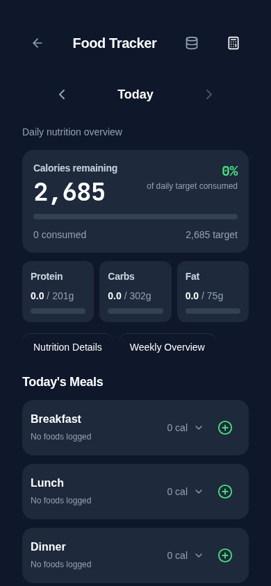
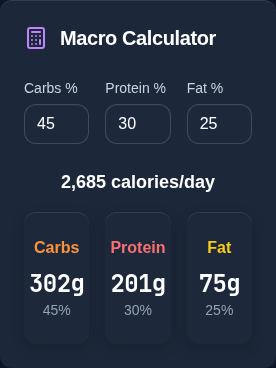

# Calculator-controlled nutrition targets

Follows merged PR #54. This change supersedes the separate Nutrition Goals UI introduced with Food Tracker 2.0, at the user's request.

## Before and after

Previously, saved `fitcircle_nutrition_goals` overrode the Fitness Calculator. Without that override, the dashboard still used a one-time snapshot of calculator targets. Changes made inside the calculator did not refresh the mounted Food Tracker because browser `storage` events are not emitted in the writing tab.

Food Tracker now reads the existing `fitness_calc_target_*` values as its only configured target source. Calculator updates publish a same-tab event after saving, and Food Tracker also responds to other-tab storage changes. Daily calories/remaining calories, macro progress, Nutrition Details and Weekly Overview use the same calculator targets. Consumption totals are unchanged. When no valid calculator targets exist, the existing reference values remain explicitly labeled with guidance to use Fitness Calculator; the existing calculator toolbar button opens it.

The Nutrition Goals popup/button/component are removed. Macro Calculator exposes only Carbs %, Protein % and Fat %; Standard, High Protein, Low Carb, Tailored selector buttons and Compare Styles are removed. Saved personal percentage fields remain editable and persist across reopening/reloads. Percentages must be finite, between 0 and 100, and sum to 100 before target publication; incomplete or invalid edits retain the last valid targets. A target-write error is displayed instead of announcing a successful dashboard update. Existing calorie/BMR/TDEE and macro gram conversion formulas remain in use.

## Preservation and scope

- No food entries, dates, historical nutrition, saved products, profile measurements or workout records are migrated or rewritten.
- Existing calculator storage keys and serialized values remain compatible with backups. Legacy `fitcircle_nutrition_goals` bytes are retained and still supported by existing backup validation/helpers; they no longer control the dashboard. The obsolete `fitness_calc_macro_style` value is retained without being read or overwritten; personal percentages control macros now.
- Existing saved custom percentages are used directly, with the calculator's existing 40/30/30 defaults if absent. Previously selected preset styles no longer select a macro distribution. No automatic deletion of old settings occurs.
- Missing age handling remains intact: calorie/macro targets need a saved age or date of birth; existing targets are kept when age is unavailable.
- The storage inventory reflects removal of the two obsolete macro-style accesses. No storage format, dependency, navigation, safe-area, camera, service-worker or deployment changes.

## Validation

Final local results on 2026-10-20:

| Check | Result |
| --- | --- |
| `npm run check` | Passed |
| `npx tsc --noEmit -p tests/tsconfig.regressions.json` | Passed |
| `npm test` | 234 passed, 0 failed |
| `npm run audit:storage -- --write-inventory` | 209 call sites, 0 errors; inventory updated |
| `npm run build` | Passed; existing chunk-size advisory remains |
| `PLAYWRIGHT_CHROMIUM_EXECUTABLE_PATH=/usr/bin/chromium npm run test:e2e` | 191 passed, 0 failed (2.6 minutes) |
| `git diff --check` | Passed |

An earlier focused browser run passed all 41 cases covering nutrition, calculator editing, overlay bounds and scroll behavior. Regression coverage now verifies same-tab calculator changes, valid/invalid personal splits, persistence, other-tab updates, obsolete-goal isolation (including malformed old bytes), historical diary preservation, target quota errors and existing complete backup restoration. All data is synthetic.

## Screenshots

Chromium 390 × 844, isolated synthetic profile and calculator data. No physical iPhone verification is claimed.

| Calculator-driven Food Tracker | Personal macro percentages |
| --- | --- |
|  |  |
