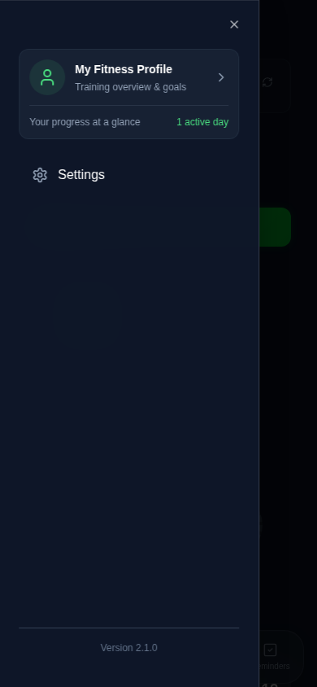
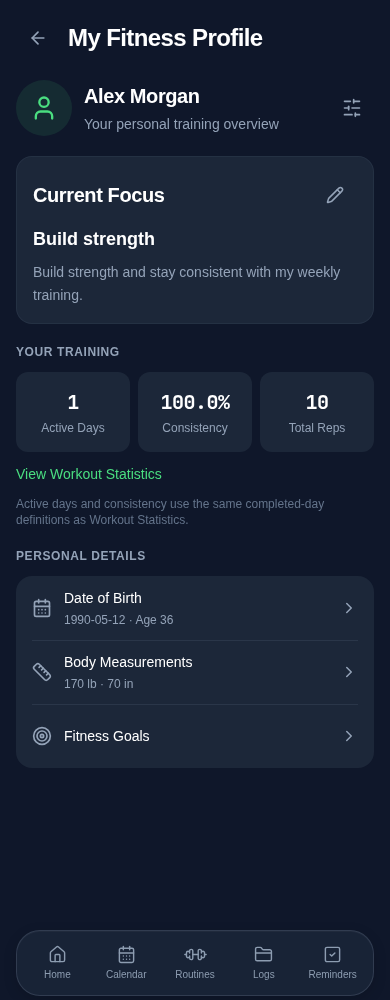

# My Fitness Profile review

## Scope and behavior

The Home sidebar Profile row becomes a compact My Fitness Profile card with its existing navigation/return behavior and a completed-days preview. The existing `/profile` route becomes an overview with editable name, optional date of birth, structured objective and existing free-form goal; shared training totals; and a read-only measurement preview linking to Measurements. No dashboard destination or dock changes.

The Calendar all-time calculation was extracted unchanged into `workout-statistics.ts`. Both the hook and the read-only Profile summary call it. Active Days uses the existing completed-day definition (including its existing recovery-day rules), not a new activity formula. Monthly and individual calculations remain untouched.

## Storage and calculator compatibility

- Existing name, manual age and free-form goal keys remain readable. No age is deleted or converted into an inferred birth date.
- Optional `dateOfBirth` and `primaryObjective` live inside the existing `fitcircle_profile` object. Explicit edits merge into the latest record, preserving age, sex/gender and unknown metadata. No new storage keys or backup version.
- Opening Profile never initializes/autosaves workouts, measurements or default preferences. Malformed/unavailable profile records block editing and explain retry/verified-backup recovery rather than overwriting bytes. Explicit multi-key saves use the existing journaled atomic restore boundary, including quota rollback.
- Complete v2 and legacy JSON backup paths accept and preserve these fields through the existing passthrough profile schema. Registry description and generated storage inventory updated.
- Age precedence: valid explicit DOB, compatible calculator-profile age, then compatible legacy Profile age. Local calendar boundaries avoid UTC birthday shifts. February 29 birthdays advance on March 1 in non-leap years. Foreground refresh, visibility/focus events and a minute interval keep age current without storage writes.
- Intentional calculator correction: no invented age 25 or transient initial target save. When age is missing/unreadable, calculated targets show an explicit missing-age notice and existing saved targets remain intact. A valid DOB changes age-dependent results as expected; objective edits do not alter calculator preferences or targets.
- Calculator sex/gender, formulas, activity settings, height/weight defaults and existing last-array-entry measurement selection remain unchanged. Profile preview independently selects the latest valid dated weight/height without modifying history.

## Changed files

- `client/src/pages/profile.tsx`: overview and explicit editors.
- `client/src/pages/home.tsx`: Home sidebar card only.
- `client/src/pages/fitness-calculator.tsx`: shared age resolution and missing-age guard/message.
- `client/src/lib/fitness-profile.ts`: safe profile reads/edits, DOB, read-only summaries.
- `client/src/lib/workout-statistics.ts`, `client/src/hooks/use-workouts.ts`: shared existing all-time calculation.
- `client/src/lib/storage-registry.ts`, `docs/audits/persistent-storage-inventory.md`: audited metadata/inventory.
- New `tests/fitness-profile.test.ts` and `tests/browser/fitness-profile.spec.ts`; existing persistence/initialization/viewport tests updated only for the replacement Profile UI. Complete-storage fixture includes legacy and new metadata; regression TypeScript config includes new tests.
- This report and two requested review screenshots.

## Screenshots

Synthetic records in desktop Chromium at mobile widths; these are not physical iPhone captures.

## Validation

- `npm run check`: passed.
- `npx tsc --noEmit -p tests/tsconfig.regressions.json`: passed.
- `npm run audit:storage`: 212 call sites, zero errors.
- `npm test`: 210 passed, zero failures.
- `npm run build`: passed; existing Vite large-chunk advisory remains.
- `PLAYWRIGHT_CHROMIUM_EXECUTABLE_PATH=/usr/bin/chromium npm run test:e2e`: 166 passed, zero failures.
- `git diff --check`: passed.

An initial focused run exposed an incorrect test route and a test expectation that assumed sorted calculator measurements. The tests were corrected to use the existing Food Tracker calculator entry and its preserved last-array-entry semantics. No unrelated calculator measurement behavior was changed. The complete final browser run passed.

## Limitations

Physical iOS Safari/Home Screen PWA and the native date picker/keyboard were not tested. Automated Chromium coverage checks 320px, 390px, 430px and desktop width, wrapping, last-row reachability above the existing dock, no automatic input focus, sidebar return, age/birthday updates, calculator compatibility, unchanged history, malformed data, quota rollback and backup round trips. Existing formulas and legacy metadata are intentionally retained; this is not a general persistence migration or calculator redesign.
