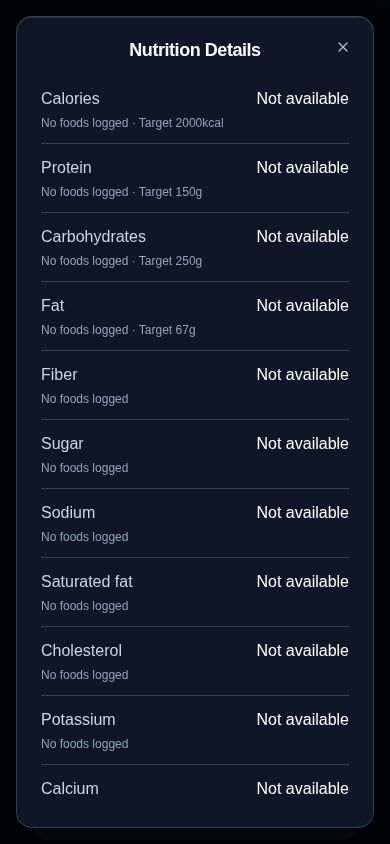
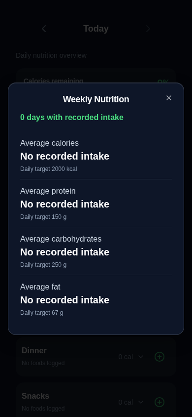
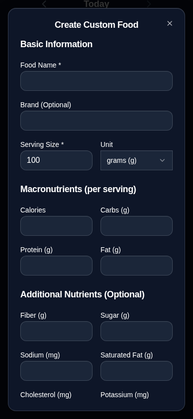
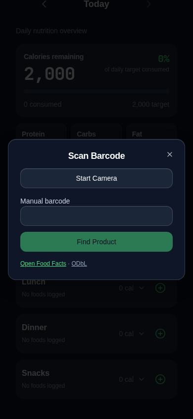

# Food dialog copy cleanup

Presentation-only follow-up to merged PR #55, matching the four highlighted screenshots:

- Nutrition Details: remove the introductory explanation and visible date/local-tracking subtitle.
- Weekly Nutrition: remove the averaging explanation and visible date/local-tracking subtitle.
- Create Custom Food: remove the explanatory subtitle.
- Scan Barcode: remove introductory, offline/privacy and barcode-format explanations. Keep compact Open Food Facts / ODbL attribution links.

Field labels, brand labels, nutrients, targets, missing/partial-data indicators, recorded-day counts, errors and controls remain unchanged. Brief screen-reader descriptions retain date context and dialog accessibility. No calculations, storage, camera lifecycle, logging, backup, dependency or PWA behavior changed.

Validation: application TypeScript and regression-test TypeScript checks passed; 234 unit tests passed; storage audit found 209 call sites and 0 errors; production build passed with the existing chunk-size advisory; all 20 nutrition browser tests passed (25.8 seconds); diff check passed. The unrelated full browser suite was not rerun for this copy-only change. All screenshots use isolated synthetic data in Chromium at 390 × 844; physical iPhone testing is not claimed.

| Nutrition Details | Weekly Nutrition |
| --- | --- |
|  |  |

| Custom Food | Scan Barcode |
| --- | --- |
|  |  |
