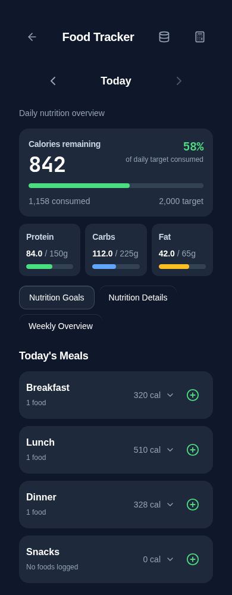
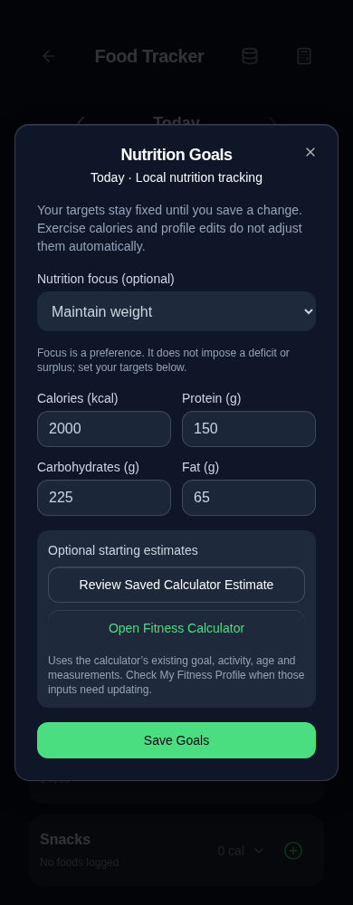
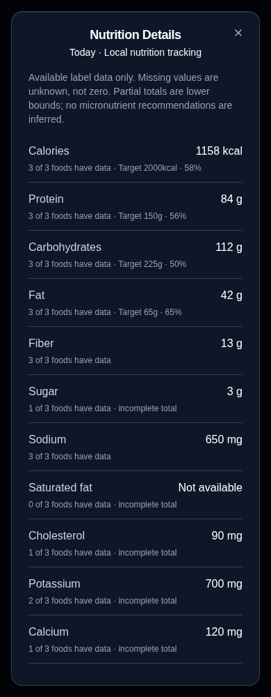
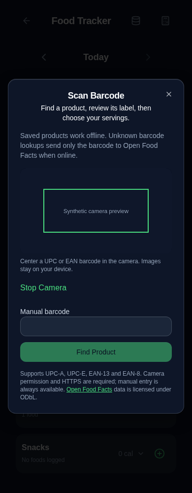
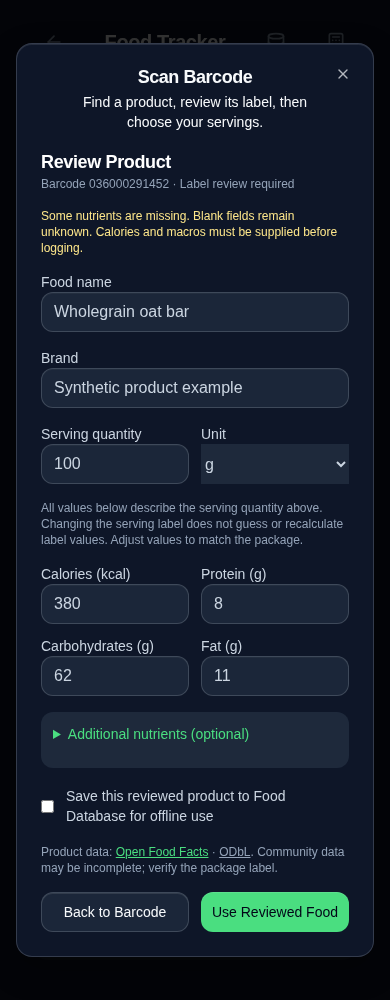

# Food Tracker 2.0 review

## What changed

Food Tracker now has a compact daily calorie summary (consumed, remaining or above target), three macro indicators, explicitly saved Nutrition Goals, grouped meal cards and per-food details, a Nutrition Details dialog, a seven-day summary, and barcode entry with product review. Search, recent foods, custom-food editing/deletion, historical date navigation, the existing Calculator and Food Database remain available.

Search, barcode review and creating a custom food all lead to the existing serving-and-meal confirmation. A new custom food is saved to the database first; logging it remains a separate confirmation. Optional nutrient fields start blank, and explicit zeros are preserved. Expanded meal rows retain brand, serving quantity, calories and macros; their serving/meal editor and delete action are retained.

The work is modular: the page integrates eight components under `client/src/components/nutrition/`, with separate nutrition, diary, barcode-validation and product-normalization helpers. Unreachable manual-entry/edit code, the old circular summary and four duplicated meal layouts were removed. The food page is smaller than before; the built-in food dataset is unchanged.

## Confirmed defects corrected

1. The old date-load effect and unconditional autosave could write the previous render's entries into the newly selected date. Opening a malformed day could also save its fallback empty array. The new diary hook never autosaves initialization: it validates a day, retains the original bytes, and persists explicit edits before updating state.
2. Add/edit handlers also wrote directly to today's key, regardless of the selected historical date, and swallowed write failures before reporting success. Those writes are removed. One selected-date commit boundary handles add, edit and delete; failed writes keep the draft and report an inline error. A changed stored snapshot blocks a stale save and offers reload.
3. Adding a searched food copied only a subset of its nutrients. The entry now retains all nutrition/source metadata, then applies the serving multiplier at calculation time.
4. Catalog reads previously returned an empty array for unreadable JSON, allowing later operations to replace it. Readers now validate and throw; mutations fail without replacing original bytes. This is necessary for safe scanned-product saves as well as existing custom-food operations.
5. Newly saved custom-food per-100g references previously assumed any quantity was grams. References now use known g/oz mass only; cups, pieces, ml and arbitrary servings do not acquire an invented density/weight. No existing catalog record is bulk-recalculated. Zero/invalid serving quantities are rejected rather than replaced with 100.

## Goals and calculation semantics

- `fitcircle_nutrition_goals` is the only new persistent key: `{calories, protein, carbs, fat, purpose?}`. Targets are finite/nonnegative; calories must be positive. Unknown metadata is preserved on explicit saves.
- No goals are written on page load. Until goals are confirmed, a read-only snapshot of existing calculator targets is shown as reference targets; if unavailable, clearly labeled reference values are used. Calculator estimates are optional, can be copied into the editor for review, and require Save Goals to apply. Every target is manually editable.
- Purpose is optional preference metadata. It does not impose an automatic deficit/surplus. The existing Calculator remains the place to review its activity/weight-goal calculations and Profile inputs.
- Confirmed targets never poll or follow calculator/profile changes. No exercise calories are added. There is no second DOB, age or measurement store, and no Calculator/Profile production changes.
- Entries retain their existing base nutrition plus `servings` representation. Totals multiply each known nutrient once. Confirmed zero counts as available data; absent values stay absent. Nutrition Details reports coverage and incomplete lower-bound totals rather than assuming missing values are zero. Only confirmed calorie/macro targets are used in its target comparisons.
- Weekly Overview uses the seven local-calendar days ending on the selected date, dividing by days with nonempty recorded intake only. Explicit zero-calorie entries count as recorded; unlogged days and unreadable days are excluded, with unreadable-day counts shown. Comparisons use current confirmed targets, not inferred historical targets.

## Barcode architecture and external API

- `@zxing/browser` 0.2.1 and its explicit `@zxing/library` ^0.23 peer provide a browser-camera decoder. Decoder imports are deferred until camera use. Retail formats are restricted to UPC-A, UPC-E, EAN-13 and EAN-8. Check digits are validated; UPC-E expansion and equivalent UPC-A/EAN-13 identities are supported.
- The scanner owns its MediaStream. Stop, dialog close, successful decode, hidden-page transition, decoder errors and late permission resolution release tracks. No camera image is sent to a server. Manual entry remains available when camera access fails.
- Lookup checks the saved local database first. Only an unknown barcode requests Open Food Facts' public v3 product endpoint. Requests contain the barcode and minimal product fields, FitCircle app/version/contact identification parameters, no account credentials, no personal logs and no photos. No remote search-as-you-type, telemetry, API secret or backend.
- Browser code cannot reliably override the browser's User-Agent header. The query carries `app_name`, `app_version` and `user_agent` with the repository contact URL; verify provider acceptance/registration before release. The owner should register the app using Open Food Facts' published API usage form. Public read operations require no account login in FitCircle.
- External calls are user-triggered, at least 4.1 seconds apart, with no automatic retries, a 12-second timeout and actionable offline/not-found/429 errors. Saving a reviewed product is optional and explicit. A duplicate ID/barcode is rejected; no saved/customized product is overwritten. A reviewed food can still be logged without saving a database copy.
- Normalization handles current v3 sets and legacy flat nutrition responses. It selects one serving/100g/100ml basis, converts known units and kJ, converts sodium/salt correctly, preserves confirmed zero, rejects mismatching product codes and leaves missing/invalid/bounded nutrient values unknown. No generic cup weight or ml-to-g density is invented. Prepared/estimated sources are called out for package verification.
- Calories and all three macros are required before logging; users must supply missing values from the package, including explicit zeros. Optional nutrients remain blank. Product review explains that changing the serving label requires matching nutrition values, not an automatic guessed rescale.
- Open Food Facts attribution, product links and ODbL links appear in review. Saved records keep source metadata. No proprietary code/assets or product photos are copied.

Documentation reviewed: [Open Food Facts API introduction](https://openfoodfacts.github.io/openfoodfacts-server/api/), [v3 schema](https://github.com/openfoodfacts/openfoodfacts-server/blob/main/docs/api/ref/schemas/product_nutrition_v3.yaml), [response schema](https://github.com/openfoodfacts/openfoodfacts-server/blob/main/docs/api/ref/responses/response-status/response_status.yaml), and the installed ZXing package README/types. The API currently documents a 15-product-reads/minute/IP limit; local lookup avoids unnecessary external reads.

## Storage and backup compatibility

Existing dated `fitcircle_food_YYYY-MM-DD` keys, catalog key, entry fields, legacy duplicate date keys, IndexedDB migration records and backup version 2 are preserved. There is no destructive migration, history reset, unrelated-key deletion or bulk nutrient rewrite. Existing unrecognized entry/catalog metadata is retained. The legacy duplicate-key namespace remains untouched; ambiguous records are not automatically merged into dates.

The new goals key is registered and validated through the existing backup registry. New saved products use the existing food database, and source metadata uses its existing passthrough schema. Complete export/restore fixtures now cover goals and scanned products; old accepted JSON files remain accepted without requiring the new key. The backup engine, existing validators, service worker and deployment configuration are otherwise unchanged. The removed dynamic audit exception is no longer used because recent history now reads through the date-scoped validated helper; generated inventory reflects the actual readers/writers.

Single-key diary writes rely on localStorage's atomic `setItem`; quota failures keep the previous value. A stale snapshot check detects changes made before commit. This does not introduce a multi-tab merge/conflict-resolution architecture for the entire application.

## Changed files

- `client/src/pages/food-tracker.tsx`: orchestration, shared explicit commits, existing entry forms and feature navigation.
- `client/src/components/nutrition/`: `DailyNutritionSummary`, `MealDiary`, `NutritionGoals`, `NutritionDetails`, `WeeklyNutrition`, `BarcodeEntry`, `BarcodeScanner`, `ProductReview`.
- `client/src/lib/nutrition.ts`, `food-diary.ts`, `barcode.ts`, `barcode-lookup.ts`, `client/src/hooks/use-food-diary.ts`: shared calculations, persistence guards, lookup/normalization and scanner validation.
- `client/src/lib/local-food-service.ts`: safe catalog reads, non-overwriting reviewed-product additions and known-mass references.
- `client/src/pages/food-database.tsx`: adds ml/slice options already supported by the backup format, so scanned products remain editable.
- `client/src/lib/backup.ts`, `storage-registry.ts`, `scripts/lib/storage-boundaries.ts`, `docs/audits/persistent-storage-inventory.md`: new-key validation/registration and audited boundaries.
- `package.json`, `package-lock.json`: ZXing dependencies only.
- `tests/nutrition.test.ts`, `tests/browser/nutrition.spec.ts`, `tests/food-save-safety.test.ts`, `tests/fixtures/complete-storage.ts`, `tests/tsconfig.regressions.json`: focused regressions, backup coverage and type checking.
- This report and five requested screenshots.

## Screenshots

All use isolated synthetic records and Chromium at 390px width. The API product-review example is a mocked response, and the scanner image uses a labeled synthetic canvas stream. These are not physical iPhone/camera captures.

| Daily dashboard | Nutrition Goals |
| --- | --- |
|  |  |

| Nutrition Details | Barcode entry | Product review |
| --- | --- | --- |
|  |  |  |

## Validation

- `npm run check`: passed.
- `npx tsc --noEmit -p tests/tsconfig.regressions.json`: passed.
- `npm run audit:storage`: 211 call sites, zero errors; generated inventory refreshed.
- `npm test`: 226 passed, zero failures.
- `npm run build`: passed; existing Vite large-chunk advisory remains. ZXing is imported on demand and its built assets use the existing offline precache process.
- `PLAYWRIGHT_CHROMIUM_EXECUTABLE_PATH=/usr/bin/chromium npm run test:e2e`: 182 passed, zero failures, against the final completed build.
- `git diff --check`: passed.

Coverage includes servings/known mass units, calorie balance and excess, nutrient coverage/zeros, goals and quota failures, snapshot conflicts, malformed records, backup round trips, selected-date add/edit/meal-change/delete, local offline barcode lookup, v3 and legacy normalization, missing core nutrition, explicit product persistence, camera denial, active decoder track cleanup, late permission cleanup, and 320/390/430px plus desktop layouts. Synthetic data only.

An intermediate full browser run was interrupted by preview assets being rebuilt and failed a navigation request; it was not counted as validation. The final stable-build run passed all 182 tests. No unrelated tests were changed to accommodate the feature.

## Remaining verification and limitations

- Physical iPhone Safari and installed-PWA camera permission, autofocus, scanning performance, rotation and keyboard behavior have not been tested. Chromium tests exercise synthetic video streams, permission denial, late permission resolution and resource cleanup; these do not establish real-device compatibility.
- Live Open Food Facts requests from this execution environment are blocked by its network proxy (HTTP 403). API integration uses published schemas and synthetic intercepted responses. Live CORS, app-identification acceptance and sample product accuracy still need verification on the deployed HTTPS origin. Camera scanning requires HTTPS and permission; manual entry/custom foods remain available.
- Open Food Facts data is community-maintained and can be incomplete or incorrect. Review is mandatory; no medical/nutrient recommendation engine is added. No IU-to-vitamin conversion without a known form, no invented micronutrient defaults, no density assumptions and no exercise-adjusted targets.
- Corrupt diary/catalog/goals bytes are retained, not automatically repaired. The user can retry after storage becomes available or restore a verified backup through existing Settings. Cross-tab snapshot conflicts require reloading the day before retrying.
- No merge or deployment is performed by this PR.
