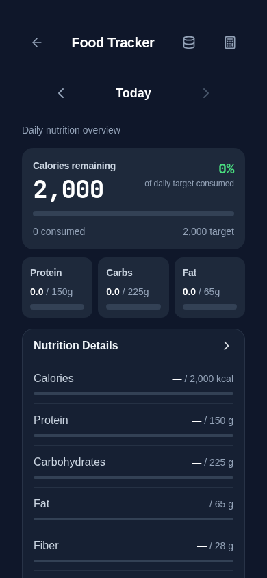
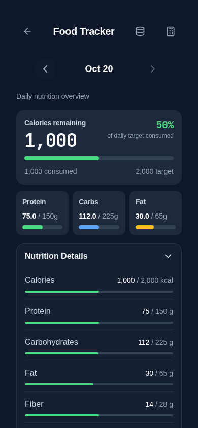

# Inline Nutrition Details

Nutrition Details is now a collapsed-by-default section directly below the calorie/macro summary. Its accessible toggle expands the same nutrient rows on the Food Tracker page, without a dialog. Selected-date changes update the expanded contents.

Empty diaries show empty tracks and a dash instead of “Not available”; existing comparison references remain visible. These neutral tracks are announced as “no foods logged,” rather than claiming a measured zero. For logged foods, known zero and unavailable nutrients remain distinct, with the existing single partial-data disclosure.

Vitamin A is excluded from this display because legacy units are ambiguous; its stored values, aggregation model and backups are retained. Weekly Overview and its unused UI component are removed. Existing historical review documents and the pure weekly aggregation helper remain available; no records or storage keys are changed.

## Verification

- Application and regression-test TypeScript checks passed.
- 281 unit tests passed.
- Storage audit: 158 call sites, zero errors.
- Production build passed.
- Nutrition Details browser tests: 10 passed, including empty diaries, missing versus zero, reference calculations, storage byte preservation, historical date switching, inline expansion/collapse and 320px layout.
- Food Tracker browser regression suite: 21 passed, including complete backup/restore, offline barcode logging, calculator targets and 320–1280px layouts. An initial run encountered the previously observed barcode-fetch flake and an outdated modal test selector; the selector was updated for the inline section and the full Food Tracker spec then passed.

Screenshots use synthetic data at a 390×844 iPhone-sized Chromium viewport. Physical iPhone/PWA verification remains manual: expand/collapse, switch dates, scroll to Vitamin C and back to meals with the dock visible, and repeat with larger text.

