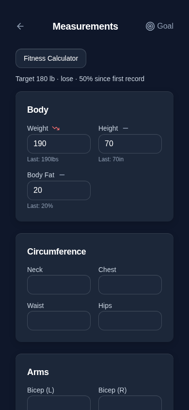
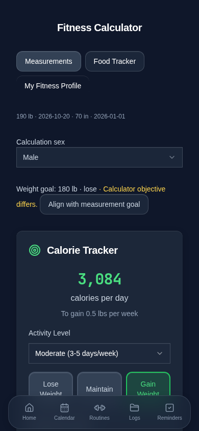
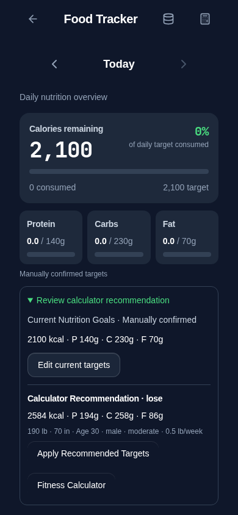

# Measurements → Calculator → Food Tracker integration

See [AUDIT.md](AUDIT.md) for findings recorded before production changes. This PR starts from main with Food Tracker 2.0 and follow-ups #53–56 merged. The latest request supersedes PR #55's automatic target adoption. It does not restore a separate Nutrition Goals page.

## Ownership and precedence

| Data | Owner and rule |
| --- | --- |
| Body measurements | `fitcircle_measurements_history`: newest valid calendar date, not array position. Canonical units remain lb/in/%. Invalid/future samples are excluded from read-only selection. Conflicting values on the newest date block a recommendation. |
| Legacy measurements | Only when history is absent: existing `fitcircle_measurements` summary, then scalar mirrors. These remain labeled **undated legacy**; no date or starting measurement is invented. A present history record is authoritative even if a particular field is missing. Legacy profile height metadata stays untouched and is not treated as measured height. |
| Weight/body-fat goals | Explicit `fitcircle_goals.targetWeight/targetBodyFat/weightGoalType`, then individual goal/direction keys, then legacy measurement summary. Deprecated `weightLbs` is a last fallback. Conflicts are displayed and original records remain untouched until explicit goal saving. |
| Profile inputs | Existing Fitness Profile DOB/age precedence, plus recorded calculation sex. Missing sex must be selected explicitly; it is stored in the existing profile record without discarding other fields. Missing weight/height/age are not replaced by 170 lb/70 in or inferred ages. |
| Calculator preferences | Existing activity, objective, rate and custom percentage keys; saved only after explicit edits. No initial/default autosave. Weight-goal alignment is offered as an action, never automatic; it preserves the chosen rate. |
| Calculator recommendation | A read-only derivation from the above, including BMR, TDEE, objective, targets and dated inputs/assumptions. No recommendation cache or new storage key. Changes refresh recommendations, not accepted targets. |
| Confirmed nutrition | Existing `fitcircle_nutrition_goals`, including existing valid manual records, always wins. Source/provenance and confirmation time use its existing JSON metadata extension. Malformed records block editing and offer Settings recovery. |
| Legacy Food Tracker targets | Existing `fitness_calc_target_*` snapshots remain untouched and can still display as **unconfirmed legacy targets** when no confirmed record exists. With neither source, labeled reference values remain read-only. Newly calculated values are never implicitly adopted. |

## Communication and UX

- A shared read-only selector/calculation layer replaces duplicated calculator state and its two-second polling writer. Same-tab integration/profile events, native storage events and window focus refresh the views without update loops.
- Measurements exposes the current goal and recorded-baseline progress, and opens the existing calculator component through a small registered route. The calculator remains available in Food Tracker's existing modal too. Calculator buttons lead back to Measurements, Food Tracker and Profile.
- The calculator shows the actual values/dates used, missing-input guidance and goal conflicts. **Align with measurement goal** changes only the calculator objective after a click.
- Food Tracker has a compact inline **Review calculator recommendation / Current Nutrition Goals** disclosure. It shows current accepted targets separately from the estimate, allows manual confirmation, and requires **Apply Recommended Targets → Confirm Apply** before adopting a recommendation. Cancellation changes nothing. If the recommendation changes during confirmation, a fresh review is required.
- Changing measurements or calculator settings does not modify daily entries, past calories or accepted targets. Manual targets and unknown metadata survive adoption/editing. Nutrition Details and Weekly Overview use the same accepted target source.
- No page redesign, new dependencies, cloud service, barcode, service-worker or deployment changes.

## Calculation and progress corrections

Mifflin–St Jeor retains lb × 0.453592, in × 2.54, male +5 / female −161, the existing activity multipliers, 500 kcal per lb/week adjustment and 4/4/9 macro conversions. Maintenance applies no weight-change adjustment but retains the user's saved rate. Macro percentages must be finite, within 0–100 and sum to 100. The recommendation calculator is limited to adults 18–120, weight >0 to 1500 lb, height 24–108 in, rate 0–2 lb/week and resulting intake 800–10,000 kcal; out-of-range inputs stop recommendations and remain stored. Manually confirmed targets still use the existing nutrition-target validation.

Weight progress now measures movement from the earliest unambiguous recorded weight toward the target, clamped to 0–100, instead of reporting near-completion simply because current and target weights are numerically similar. For 200 → 190 → target 180 lb, progress is 50%. This is explicitly labeled **since first record**, not an inferred goal-start date. Without an available baseline, Measurements shows an unavailable percentage. Shared weight progress, including the weight contribution to the existing wellness score, uses the same calculation; wellness score weights and other domain formulas are unchanged. Body-fat goals remain tracking inputs and never create a calorie adjustment.

## Persistence safety and compatibility

Measurement initialization no longer autosaves fallback state. Explicit saves validate and merge the original history, write only edited measurement fields, retain other measurement dates, maintain existing scalar mirrors, and use the existing validated transaction/rollback mechanism. A stale measurement draft is rejected rather than overwriting another tab's changes. Goal writes likewise preserve unrelated goal fields and update legacy mirrors only on explicit confirmation. Shared goal reads no longer create migrated/default records; shared goal writers reject unreadable original documents.

All storage keys and backup formats remain intact. No destructive migration occurs. Existing backup validators already support the current shapes and nutrition metadata passthrough; regression tests cover complete v2 and accepted legacy JSON restore, including confirmed targets and recommendation provenance. Legacy IndexedDB foods are neither replaced nor altered. Original malformed bytes remain available for recovery through the existing verified-backup workflow.

## Validation

Final local checks on 2026-10-20:

| Check | Actual result |
| --- | --- |
| `npm run check` | Passed |
| `npx tsc --noEmit -p tests/tsconfig.regressions.json` | Passed |
| `npm test` | 251 passed, 0 failed (17 new integration cases) |
| `npm run audit:storage -- --write-inventory` | 194 call sites, 0 audit errors; inventory refreshed |
| `npm run build` | Passed; existing chunk-size advisory remains |
| `PLAYWRIGHT_CHROMIUM_EXECUTABLE_PATH=/usr/bin/chromium npm run test:e2e` | 199 passed, 0 failed (2.6 minutes) |
| Focused integration browser rerun with populated historical food records | 10 passed (10.6 seconds) |
| `git diff --check` | Passed |

Test data is isolated and synthetic. The old automatic-adoption assertions were replaced with the new explicit-confirmation contract; profile calculation tests now verify read-only results and retained legacy target bytes. No diagnostic test-harness cleanup was bundled. Coverage includes unsorted/invalid/future/tied samples, units, missing inputs, legacy precedence/conflicts, gain/loss/maintenance, recorded-baseline progress, calculations/bounds, explicit alignment/adoption/cancellation, stale recommendation confirmation, custom targets, historical food/measurement bytes, quota rollback/retry, malformed/unavailable storage, backup compatibility, cross-tab updates, navigation and 320/390/1280 px layouts.

## Limits and manual checks

- Historical goal-start dates were not recorded; earliest unambiguous recorded weight is a transparent baseline, not an invented start of a specific goal. Undated legacy values cannot supply that baseline.
- Missing/invalid individual samples are never repaired. An explicit history edit is blocked if the existing record cannot pass existing backup validation; restore a verified backup instead. Conflicting legacy values are preserved until the user explicitly saves a goal.
- Age is re-evaluated on opening/focus/profile updates; no new background scheduler or activity inference is introduced. No exercise calories are added to allowances.
- Other persistence domains and their remaining modernization work stay on the existing roadmap. This is not a claim that all unrelated wellness persistence has been repaired.
- Physical iPhone testing has not been performed. In Safari and the installed PWA, verify Measurements → Calculator → Food Tracker navigation, keyboard dismissal and safe-area reachability, goal alignment without rate changes, cancellation, and explicit adoption. Add a measurement in another tab and verify only the recommendation changes until confirmed.

## Screenshots

Chromium at 390 × 844 with synthetic records.

| Measurements | Calculator conflict | Current targets and recommendation |
| --- | --- | --- |
|  |  |  |
