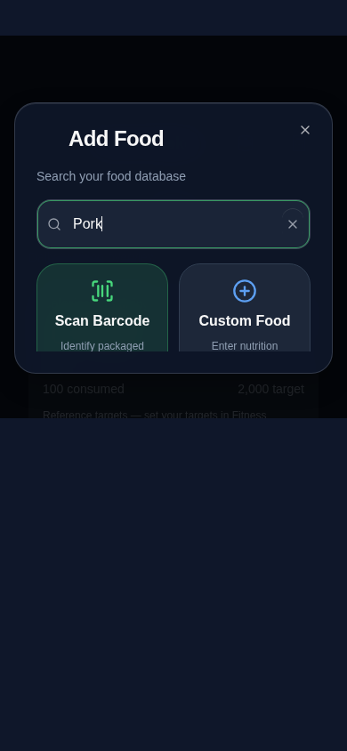
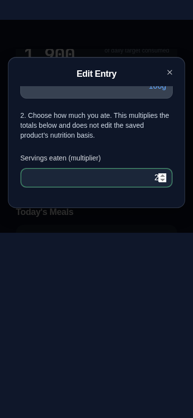

# App-wide modal field focus and containment audit

## Confirmed paths before changes

1. Shared `Input`/`Textarea` add Tailwind outer rings, while `glass.css` adds a separate 2px pale outline with a positive 2px offset. Native controls in overlays can inherit the same outline. The result extends outside the field and is cut off at a scroll container edge, matching Add Food and Edit Entry. Fixing only one page or the Input component would miss native fields, textareas and custom goal sheets.
2. Shared `.dialog-body` is the intended scrolling region, but `.dialog-body-static` explicitly prevented shrinking and made overflow visible. Compact editors could therefore extend beyond the constrained dialog when a keyboard leaves less space than the form needs. The panel's existing clipping then hides controls rather than making them scrollable.
3. Shared visual-viewport handling already follows keyboard height/offset and adjusts the active field's own scroller. Standard dialogs, nested dialogs, sheets and custom ViewportOverlay goal cards all use the same bounded overlay frame. Their viewport and focus trapping should be retained.

## Overlay coverage

| Shared owner | Existing surfaces covered |
| --- | --- |
| DialogContent / glass-dialog | Food search, custom food, Add/Edit Entry, barcode entry, food database editing, embedded Fitness Calculator, profile/goals, routine/workout editors, journal, supplements, dashboard widget settings, dynamic overview editor, cardio add/edit/custom activity type, hydration add/edit, meditation add/edit, fasting add/edit |
| ViewportOverlay / glass-dialog | Cardio, hydration, meditation and fasting goal panels, existing custom wellness overlay cards |
| SheetContent / glass-sheet | App navigation/dashboard/settings sheets and any shared/native text fields within them |

The audit found no independent `role="dialog"` text-entry implementation bypassing these owners. Confirmation-only dialogs and timer controls remain within their existing layout. Checkbox/radio/range controls and button focus are outside the text-field appearance change.

4. The Add Food list used a negative right margin with a forced inner scrollbar, overflowing its dialog body horizontally. Remove the negative margin; keep the bounded list/body scrolling.
5. Journal nested a 200px-minimum textarea inside a shrinking, overflow-hidden flex region. The field could be cut off inside that region even while the outer modal scrolled. Let the writing region take its natural size and let the real dialog body scroll it into view.

Implementation and final validation results follow below.

## Final behavior

- All shared-overlay editable inputs, textareas, native selects and combobox triggers use a single thin inset green focus cue. There is no pale outer outline or offset ring to clip at the scroll edges. Normal button focus is preserved. Forced-color mode retains a contained system-color outline.
- The shared dialog body can shrink and scroll at keyboard heights, including formerly static compact editors. Normal fitted compact forms remain stationary; headers, fixed footers and close controls retain their existing ownership. Field/grid minimum-width constraints allow small-screen containment without adding horizontal clipping.
- Add Food no longer extends its list past the body width. Journal no longer clips a large textarea inside a shrinking inner region. Long form content continues to scroll; the active field itself stays wholly visible and actions remain reachable.
- No validation, save handlers, input values, field options, calculations, modal navigation, keyboard-opening policy, storage keys, backups, service worker, or deployment configuration changed. The existing inline Reminders draft keeps its separate caret-only styling outside modal surfaces.

## Regression coverage

The new browser suite opens 23 real modal flows and focuses every visible user-facing field at normal size and a simulated 430px visual viewport with an offset. It checks no outer white outline, inset focus, horizontal containment, the active field inside its scroller, hit-testing (no covering element), reachable actions, and visible close controls. It covers both original food examples; custom food/Add Entry/barcode/database; Calculator; profile inputs/textarea; routine/workout; journal; supplements; duration; cardio/nested custom type; hydration; meditation; fasting; and all four custom wellness goal overlays.

Additional cases cover a 320px-wide compact editor with a 280px visual viewport and forced-color/ordinary-button focus. Hidden internal select helpers are excluded; visible native selects and combobox triggers are included. The original sweep caught horizontal Add Food overflow and journal textarea clipping, which were corrected. A test initially matched the dropdown library's hidden 1px select helper; the final selector targets user-facing controls.

| Add Food with focused search | Edit Entry with focused multiplier |
| --- | --- |
|  |  |

These screenshots use synthetic data and a reduced Chromium visual viewport. They do not display or claim an actual iPhone keyboard. Adjacent nonfocused form content can naturally scroll offscreen; it is not forced to fit all at once. The active field, close button and reachable actions are what the containment tests assert.

## Validation

- Application and regression-test TypeScript: passed.
- Unit tests: 281 passed.
- Storage audit: 158 call sites, 0 errors.
- Production build: passed (existing Browserslist/chunk-size advisories).
- Final focused modal sweep: **25 passed**.
- Final full browser suite: **273 passed, 1 failed** in the previously observed automatic-scan-caching test, before Add Entry opened, with “Failed to fetch”. That case **passed independently on rerun (1/1)**. All 25 modal regressions and existing persistence/backup checks passed. No barcode code, test timeouts or retry configuration changed.

## Physical iPhone / installed-PWA checklist

Physical iPhone Safari/PWA testing has not been performed. In both Safari and the installed app, verify Add Food search and Edit Entry multiplier focus: no white exterior frame, complete active-field borders and editable text, and smooth scrolling to actions. Repeat with Profile name/date/goals, routine/workout editors, journal, and wellness add/edit/goal forms. Check portrait, landscape, enlarged text, moving between fields with the keyboard toolbar, nested custom-cardio dialogs, and closing/reopening without lost draft values. Confirm that native date/number/select pickers still work and the modal's close action stays reachable. No real installed records were modified during development.
