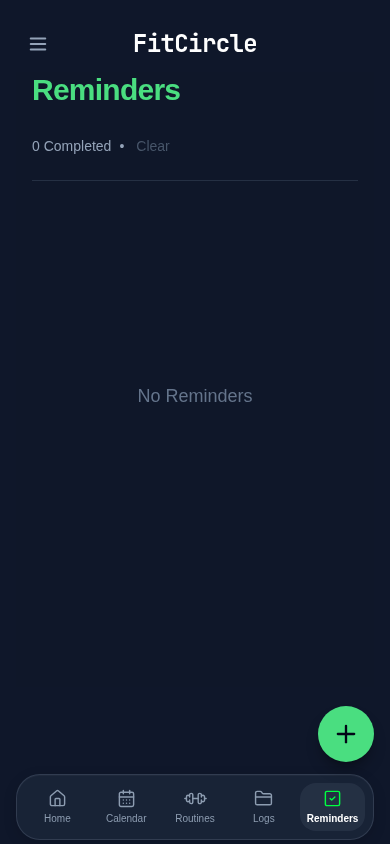
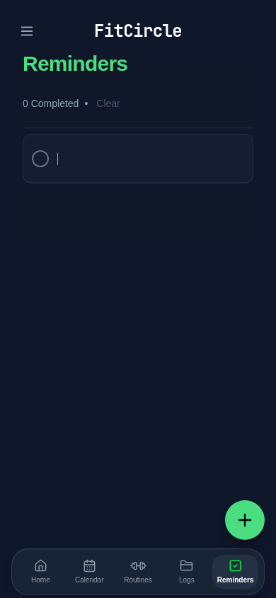

# Reminders: blank until tap

Removed the always-visible “New reminder” row. The idle page retains its existing reminders/empty-state message and floating + button. Tapping the empty-list surface or the blank area after a populated list opens the existing inline draft. That blank surface remains a keyboard-accessible button with the existing accessible name “Write a reminder”.

The draft keeps its existing outer bubble and circle, but its input has no preset text, placeholder, border, focus outline or shadow. The scoped draft-only CSS overrides the shared native-control focus outline; other inputs and keyboard focus styles are unchanged. The caret remains visible and green. Mounting/focusing still happens synchronously inside the tap handler so iOS can open its keyboard.

Return still adds the reminder at the top and keeps a fresh blank draft focused. Blank Return, Escape, Backspace/Delete on an empty draft, deleting all draft text, or blurring a whitespace-only draft retains the established dismissal behavior. Existing completion, editing, deletion, ordering and floating-button/dock behavior are unchanged. No storage, persistence, backup format or service-worker changes are included.

| Idle | After tap |
| --- | --- |
|  |  |

Validation: application and regression-test TypeScript passed; 281 unit tests passed; storage audit passed (158 call sites, 0 errors); production build passed. All 27 relevant browser tests passed (Reminders, material adoption, scroll boundaries and viewports). An initial test caught a missed completion click when dismissing the draft moved the list; dismissal now waits until a pointer action runs, while keyboard blur stays immediate.

All test records/screenshots are synthetic. Chromium checks focus and computed styles, consecutive Return entry, empty and populated lists, cancellation, persistence, scrolling, safe areas and dock clearance. Physical iPhone Safari/PWA keyboard appearance has not been verified. On-device: tap empty list space and +, verify the keyboard/caret with no nested text-field box, add two reminders with Return, then dismiss the empty draft by Backspace or tapping away.
