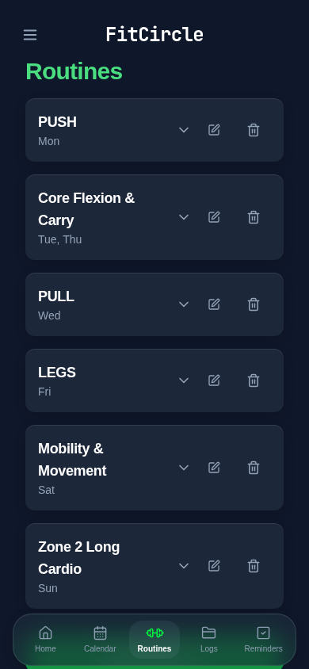
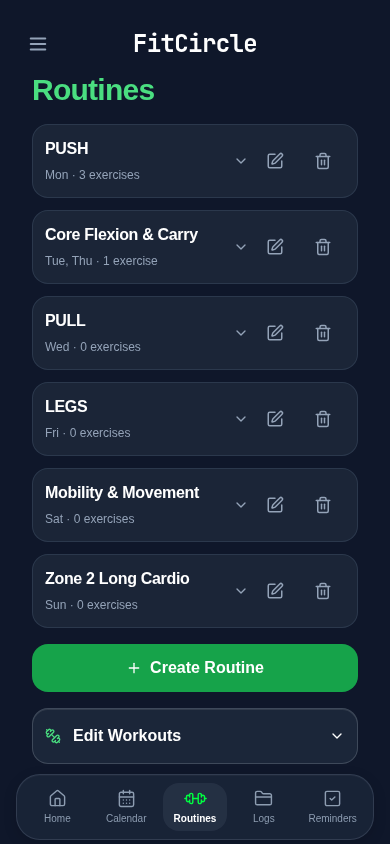
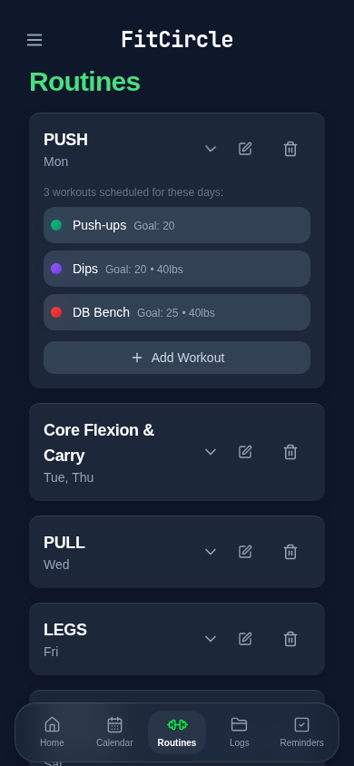
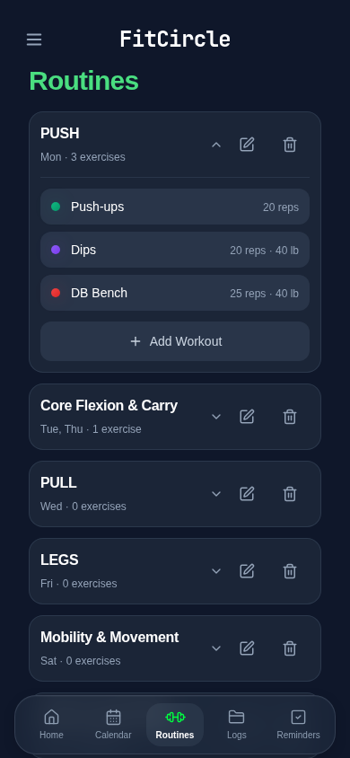
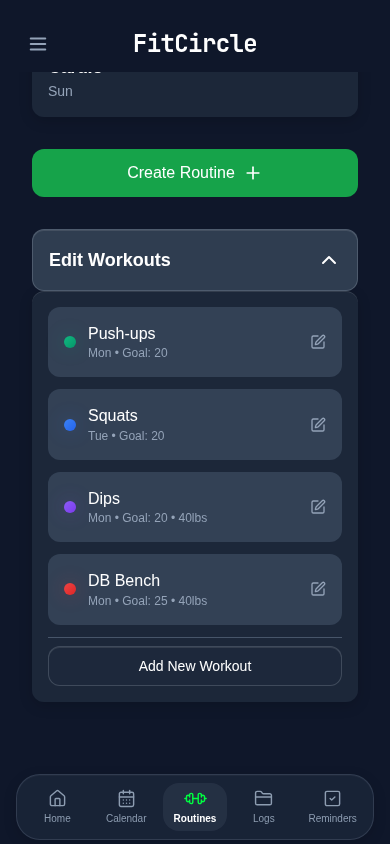
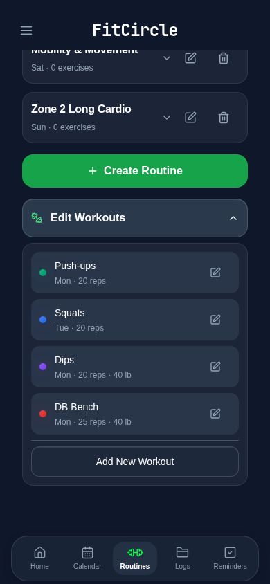

# Routines configuration UI

## Audit before presentation changes

- `routines.tsx` preserves object insertion order and independently expands multiple routine IDs in a Set. Create/edit uses RoutineModal (name + selected days), and deletion uses the existing accessible confirmation with Cancel focus and return focus.
- Membership displayed inside routines is **schedule overlap**, via `getWorkoutsByDays`: missing/empty workout schedules mean daily, otherwise any shared weekday includes the workout. No checkbox-based exercise-assignment editor exists in RoutineModal. Add Workout opens the existing full WorkoutModal with routine days preselected and creates a reusable definition. Existing exercises enter/leave a routine's list by editing schedules in Edit Workouts. The stored optional `routineId` helper remains separate from this displayed schedule-overlap behavior.
- WorkoutModal retains name, color, goal, optional weight, all seven days, presets, cancel/save, and its existing delete action. This review changes no workout editor logic.
- Home filters exercises using `isWorkoutActiveOnDay`; its routine heading is the first routine matching today. Changing routine days changes that heading and routine-list membership; it does not automatically rewrite exercise schedules. Changing an exercise's schedule/name/goal/color/weight affects its shared definition and Home display. These existing rules must remain intact.
- Calendar reads the same workout definitions/history; journal Logs use the same workout store. Reminders use their separate hook/store and no routine assignment model. None need code changes for this presentation work.
- Persistence remains `workout-tracker-data`, with unchanged hook initialization/autosave/date rollover and v2 backup validation. Routine deletion keeps exercise definitions/history, removing only existing routine links. Existing explicit workout deletion also deletes that workout's historical log entries; this behavior is unchanged, and this UI refinement neither triggers it automatically nor changes history to alter presentation.

## Scope

Presentation and accessibility only: compact slate routine cards, a name/days/count hierarchy, a keyboard-operable expansion control, restrained borders, compact colored exercise rows with goals/weights, and a compact Edit Workouts accordion. RoutineModal retains all fields, shared DaySelector behavior and fixed actions. No new assignment model, execution controls, progress indicators, session state, storage keys or migrations.

Before/after screenshots and final validation results follow below.

## Before / after (390 × 844, synthetic fixtures)

| View | Before | After |
| --- | --- | --- |
| Collapsed routine cards |  |  |
| Inline exercise list |  |  |
| Reusable workout management |  |  |

Cards retain the same order, independent expansion state and existing actions. Counts come directly from the same schedule-overlap selector used for the visible exercise list. The duplicate introductory sentence is removed. Long names and numerical details wrap; color dots and action buttons do not shrink. Routine headers now provide keyboard activation, expanded state, and content associations. No progress, session or completion controls were introduced.

The routine editor has clearer name-input spacing and 44px portrait actions. At viewport heights of 450px or less it uses the existing compact spacing/control heights, retaining every field and keeping the fixed save/cancel actions in view. Shared modal, DaySelector, header, dock, workout editor and persistence implementations remain unchanged.

## Validation

- Application and regression-test TypeScript: passed.
- Unit tests: 281 passed.
- Storage audit: 158 call sites, 0 errors.
- Production build: passed (existing Browserslist/chunk-size advisories).
- Initial focused browser run: 30 passed, 1 landscape routine-editor layout failure. Corrected short-viewport spacing; the exact landscape case then passed independently.
- New configuration regressions: all six passed in the initial focused run, including unchanged raw bytes during browsing, exercise schedule/name/goal/color/weight reuse on Home, no duplicate definitions, routine day changes, reminder preservation, full JSON backup restore, long names, keyboard expansion and dock clearance at 320/390/1280px.
- Final full browser suite: **248 passed**, including all six new configuration cases, the corrected landscape editor, existing Home/Calendar/Logs/Reminders coverage, persistence, backup and layout checks.

## Remaining verification / existing behavior

Automated layout tests use Chromium with simulated iPhone safe areas, keyboard-sized viewports, portrait/landscape and desktop sizes. Physical iPhone Safari/PWA verification is not claimed. On-device: create/edit a routine with the keyboard open, select individual days and presets, expand multiple routines, open Edit Workouts, edit a long exercise name/goal/weight/color/schedule, check Home, then scroll to the last controls and close every modal. Confirm safe-area and dock clearance in portrait and landscape.

This PR intentionally keeps the existing schedule-overlap model, routine heading selection, workout-delete semantics and persistence behavior described in the audit. It does not introduce direct per-routine assignment controls or change storage safety logic. All fixtures and screenshots are isolated synthetic data.
