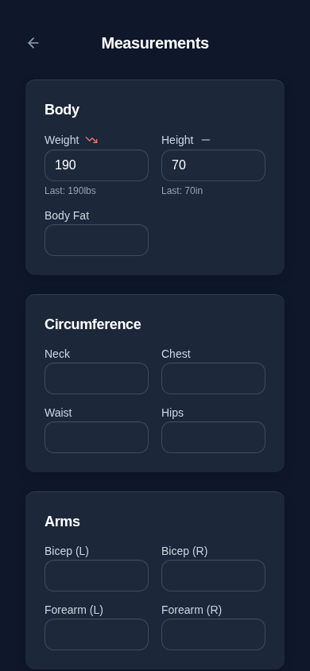
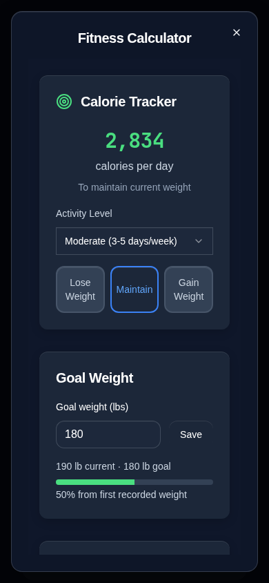

# Simplify Measurements and Fitness Calculator

This change follows the request to undo PR #57's complicated integration UI while retaining the simplified personal macro calculator. PR #57's audit and review documents remain historical evidence; its recommendation/adoption workflow is superseded by this request, not an unresolved requirement.

## Before and after

- Measurements: removes the Goal button, goal modal, goal summary/progress, alignment notices and added calculator shortcut. Measurement inputs, explicit Save Measurements and trend charts remain.
- Fitness Calculator: returns to the familiar calorie/activity/objective/rate, BMI and personal macro layout. Removes the new calculation-sex selector, measurement-date banner, navigation toolbar and goal-conflict/alignment prompts.
- Goal weight: one field and Save button live in the calculator. Previously saved target weight is reused. A compact progress indicator uses the earliest valid recorded weight, current weight and saved target; no baseline is invented when unavailable. Saving a goal does not automatically change Lose/Maintain/Gain or the selected rate.
- Weight and height: latest valid dated Measurements values feed BMI and Mifflin–St Jeor calorie calculations quietly on opening and same-tab/cross-tab changes. Missing measurements do not become fabricated 170 lb/70 in inputs.
- Food Tracker: restores direct calculator-target updates, removing the recommendation review/manual target editor and Apply/Confirm flow. No separate Nutrition Goals screen returns. Personal Carbs %, Protein % and Fat % remain; macro presets/comparison options remain removed.
- Removes the unused recommendation hook, recommendation engine and target-review component. Small existing measurement selectors, explicit writes and malformed-data protections remain to preserve records.

## Data and compatibility

No storage keys, serialized formats, registry schemas or backup formats change. Existing weight/body-fat goals and legacy mirrors are retained, even though Measurements no longer offers goal editing. Explicit calculator weight-goal saves reuse the existing shared target and legacy mirrors while preserving unrelated goal fields. Historical measurement dates and food entries are not rewritten; a weight-only measurement save does not re-record prefilled height/body-fat.

Stored nutrition-goal records from the superseded adoption UI remain backed up and unchanged, but the dashboard again follows calculator targets, as requested in the earlier calculator simplification. Calculation sex continues the pre-PR #57 behavior: saved female/male profile value, with the pre-existing male default when absent.

Calculator settings save on user edits rather than re-saving fallback settings on mount. Complete calorie/macro updates use the existing validated, journaled writer. Invalid macro splits or missing/malformed measurement inputs retain saved targets.

The new persistent-failure regression exposed a necessary narrow correction in the shared rollback helper: when the first write fails without changing existing data, rollback must not remove those unchanged original bytes and then attempt to write them through the same failing storage. Rollback now touches only changed values. Its audited generic read is registered; backup keys/formats and journal recovery remain unchanged.

## Validation

All fixtures and screenshots use synthetic data.

| Check | Actual result |
| --- | --- |
| Application TypeScript, `npm run check` | Passed |
| Regression TypeScript, `npx tsc --noEmit -p tests/tsconfig.regressions.json` | Passed |
| Unit tests, `npm test` | 247 passed, zero failures |
| Storage audit, `npm run audit:storage -- --write-inventory` | 200 call sites, zero errors; inventory regenerated |
| Production build, `npm run build` | Passed; existing Browserslist age and bundle-size warnings remain |
| Full browser suite, system Chromium via `PLAYWRIGHT_CHROMIUM_EXECUTABLE_PATH=/usr/bin/chromium npm run test:e2e` | 197 passed, zero failures |
| `git diff --check` | Passed |

The first full browser run passed 196/197: an older material test selected the first input positionally, which now refers to the explicit-save goal-weight field. It now selects Carbs % by label, preserving its original macro-persistence assertion. The subsequent full run passed all 197 tests. Obsolete recommendation/adoption tests were replaced with coverage of the requested simpler workflow; historical measurement, shared goal and backup fixtures remain.

## Limits and manual checks

- Automated browser coverage uses desktop Chromium at iPhone-sized viewports. Physical iPhone Safari/PWA behavior has not been tested.
- Progress is explicitly measured from the first recorded weight, not an invented goal-start date.
- Goal weight is independent of the existing calorie objective/rate; changing it does not infer a diet plan.
- Persistent storage failures after partial writes still rely on the existing recovery journal/reload path. Browser eviction and denied storage remain platform limitations.
- Existing diagnostic timing cleanup remains separate.

## Screenshots

