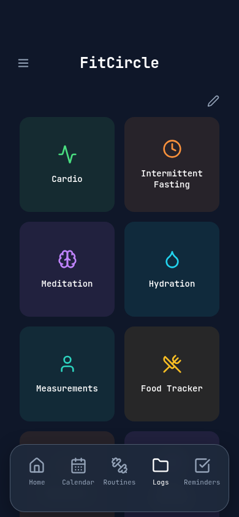

# Stage 1: compact dock and layout audit

All screenshots and numbers here are Chromium mobile simulation, 390×844 CSS px,
with injected safe areas 59/34. No physical iOS 26 measurements were available.

| Measurement | Main before | Stage 1 |
| --- | --- | --- |
| window / document / visual height | 844 / 844 / 844 | unchanged |
| visual offset / scale | 0 / 1 | unchanged |
| shell bottom | 844 | 844 |
| main scrollport top → bottom | 131 → 844 | unchanged |
| capsule height | 111 | 89 |
| capsule top → bottom | 725 → 836 | 721 → 810 |
| whole dock overlay height (including safe area) | 119 | 123 |
| capsule bottom padding | 34 | 12 |
| outer bottom gap | 8 | 34 (actual safe area) |

The capsule was oversized because #6 replaced its symmetric 12px bottom padding
with the full safe-area inset. The inset belongs outside a compact capsule, not
inside its material. The capsule is 22px shorter here with unchanged icons, font,
button height and width. The whole overlay measurement includes the outer safe
area and is used only for end-of-page clearance, never scrollport height. On
non-notched displays an 8px minimum edge gutter remains.




Complete measurements: [before](geometry-before.json), [after](geometry-after.json).
The probe records shell, scroller, inner page, dock, nav, and the complete ancestor
chain, including overflow, sizing, padding, transforms, clipping, scroll metrics,
resolved safe areas, scale and standalone state. It never reads fitness storage.

## Remaining physical-device requirement

There is **no premature boundary in this current Chromium baseline**: main ends
at 844; no ancestor clips it earlier. The only vertical clip is main's own viewport
edge. We cannot identify a physical iPhone WebKit paint boundary from these
measurements, and do not claim the persistent iOS clipping defect is fixed.
Accordingly, this stage retains the working shell/header/keyboard/overlay sizing
instead of adding another unverified height or offset. Previous #4's confirmed
flex-footer clipping was already removed by #5.

For the affected iPhone 16/iOS 26, capture Safari and installed PWA geometry while
the cutoff is visible. In Safari remote Web Inspector paste the function body
from `scripts/viewport-probe.mjs` (omit `export`), then run
`JSON.stringify(captureViewportGeometry(), null, 2)`. Compare the cutoff against
main/shell/ancestor bottoms; repeat after rotation and with keyboard closed/open.
This is required before claiming the physical clipping acceptance criteria met.

## Reproduce review captures

Run a production preview on 4175 and:

```sh
PLAYWRIGHT_CHROMIUM_EXECUTABLE_PATH=/usr/bin/chromium \
  node scripts/capture-ui-review.mjs /tmp/fitcircle-review
```

The executable override is optional when Playwright's bundled Chromium is
installed. `REVIEW_BASE_URL` can override the preview base. The script creates a
fresh context with synthetic routines and captures Home, Logs, Routines, Calendar,
Reminders, sidebar, Food Tracker, calculator and an editing dialog. It never uses
an existing browser profile. Captures are artifacts, not pixel-perfect assertions.

Validation: TypeScript, 29 unit tests, production build and 28 Chromium Playwright
tests pass. Small/large iPhone, portrait, landscape and desktop checks require compact
89px capsule height, 44px minimum touch targets, safe button bounds, continuous content
intersection beneath the dock, and final Logs/Routines clearance. Existing header,
sidebar, calculator, keyboard, scroll lock, offline and persistence checks remain.
