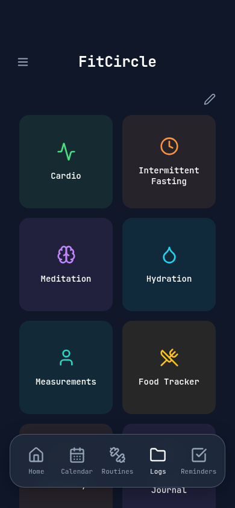
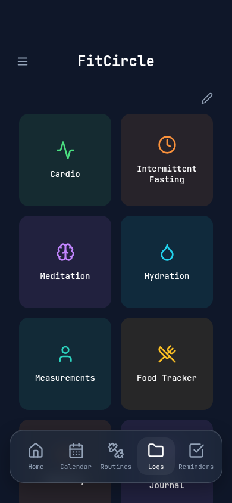
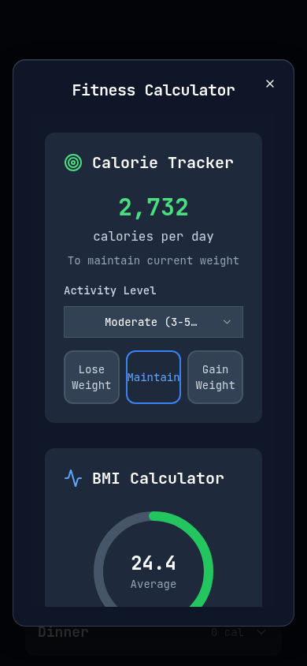

# Stage 2: shared navy glass materials

Depends on stage 1/PR 7. Review incremental commits after the compact-dock stage;
all branches target main but must be reviewed/merged in order, with explicit
approval. The later PR includes its prerequisites until they reach main.

`client/src/styles/glass.css` owns semantic tokens and material utilities:

| Token group | Values / purpose |
| --- | --- |
| surface | navy 30/ 41/ 59 at 90%; opaque fallback |
| elevated | navy 15/ 23/ 42 at 96%; opaque fallback |
| interactive | navy 30/ 41/ 59 at 88%; no nested filter |
| navigation | navy 30/ 41/ 59 at 82%;12px blur, 125% saturation |
| border / top highlight | slate 203/ 213/ 225 at 20%; white at 10% |
| shadow / elevated |4px/ 14px or 12px/ 32px black at 16%/ 28%, plus subtle inset highlight |
| blur |8px/ 12px/ 16px; only nav and elevated overlays consume filters |
| radii |8px/ 12px/ 24px; existing component radius remains authoritative |
| timing |120ms/ 180ms; color, shadow and small pressed feedback only |

Primitives: `glass-nav`, `glass-card`, `glass-panel`, `glass-dialog`, `glass-sheet`,
`glass-button`, `glass-input`, `glass-toolbar`. Opaque backgrounds are the default;
only a supported backdrop-filter gate enables translucency and standard/WebKit
filters. Cards/panels/controls do not add expensive nested blur. The nav and a
single active dialog are the primary filtered surfaces. No animated filters,
full-screen backdrop blur, `will-change`, new dependencies or measurement loops.

Integration in this stage: the compact dock, shared Card and shared DialogContent.
Existing Radix layout, body scrolling and safe close targets are untouched. The
nav's inline styles are consolidated into geometry/material classes, preserving
89px height, typography, icons and proportions. Active tab has `aria-current`,
a subtle inset selection surface and white text; inactive remains slate 400.
Keyboard focus has a visible 2px outline; pressed feedback is optional.

## Accessibility and compatibility

- Opaque fallback when filtering is unsupported; covered by a test that disables
  the CSS support gate (not an actual older-engine run).
- `prefers-reduced-transparency` selects opaque surfaces and disables filters.
- `prefers-reduced-motion` disables material/descendant animations and transitions.
- Forced-colors uses system surfaces, borders and selected-tab colors.
- Forms/dialogs use 96% navy so background text does not interfere with reading.
- Foreground colors and typography remain unchanged. Actual device readability,
  contrast under all content and scrolling performance still require review.

## Visual review

Chromium mobile captures, injected 59/ 34 safe areas; no physical iOS verification.

| Component | Before | After |
| --- | --- | --- |
| Dock / Logs |  |  |
| Elevated calculator |  |  |

All 9 review scenes were captured with the script from stage 1. Shared Card's
material is used by existing hydration/cardio/fasting screens as well. The rest of
the application adopts primitives in stage 3; color-specific surfaces retain their
original colors rather than inheriting generic gray glass.

Validation: TypeScript, 29 unit tests, production build and 32 Chromium Playwright
tests pass. New tests cover compact geometry, semantic selection, keyboard focus,
near-opaque calculator/close access, reduced motion/transparency and opaque fallback.
The existing full scrolling, overlay, offline, backup and fitness suites still pass.
No actual iOS/Safari/Firefox/Android engine or physical-device performance run.
