# Stage 3: application material adoption

Depends on PR 7 (compact dock/audit) and PR 8 (design system). All PRs target main,
but later branches contain prerequisite commits until earlier stages merge.
Review the incremental stage 3 diff and merge in order only with explicit approval.

## Updated surfaces

| Page / component | Treatment |
| --- | --- |
| Home | Workout-session, empty-state and supporting panels; QuoteOfTheDay material. Progress circles, counters, workout colors and actions unchanged. |
| Logs / wellness | Colored tiles gain fine inset edges, subtle light and depth. Background colors, icons, two columns and edit/reorder behavior unchanged. |
| Routines | Cards and supporting panels use shared navy material; expansion/editing structure unchanged. |
| Calendar | Toolbar material and cell highlights; completed/recovery colors and inline status glows unchanged. |
| Reminders | Soft row surfaces, consistent input/focus and action-menu material; completion and persistence unchanged. |
| Food Tracker | Meal headers and entry cards use panel material. Shared forms/dialogs cover all editing flows. |
| Fitness Calculator | Legacy card utilities, shared inputs/selects and neutral macro cards; goal colors, math, settings, body scrolling and safe close behavior unchanged. |
| Cardio, hydration, fasting, meditation | Shared cards and legacy card utilities; neutral controls/panels adopt the material system. |
| Measurements, energy, supplements, recovery, statistics, daily overview | Neutral panels and native form surfaces adopt shared materials. |
| Journal log, Settings | Entry panels or settings panels get material depth; no storage/backup/action logic changes. |
| Profile, food database and other shared-form consumers | Inherit shared Card/Input/Select/Textarea/Button utilities without per-page rewrites. |
| Shared Sheet, ViewportOverlay | Elevated, nearly opaque navy material; layout/portal/focus/lock behavior untouched. |
| Shared Button/Input/Textarea/Select/Switch | Material/focus/pressed treatment; destructive and brand button colors, toggle state colors, validation and event handlers retained. |

Only styling classes and material CSS change in application sources. No functions,
models, localStorage/IndexedDB keys, calculations, service workers, backup formats,
network behavior, dependencies or fonts are changed. Header geometry is untouched.

## Intentional exceptions

- The header/status-bar protection stays opaque and has no backdrop filter. This
  preserves the physical-iPhone-confirmed top repair.
- Colored wellness tiles, calendar status cells, progress rings and selected
  goal controls keep their original colors. They receive no generic gray surface.
- Default/colored/destructive buttons keep their backgrounds; only neutral
  outline/secondary buttons adopt the navy surface. All share focus/press cues.
- Small nested controls and cards do not blur their backgrounds. Only navigation
  and elevated overlays use filters, with no animated blur or full-screen filter.

## Visual review

Before is stage 2, after is this adoption. All nine scenes are Chromium simulation,
390×844 with injected 59/ 34 safe areas and synthetic records, not iOS screenshots.

| View | Before | After |
| --- | --- | --- |
| Home | 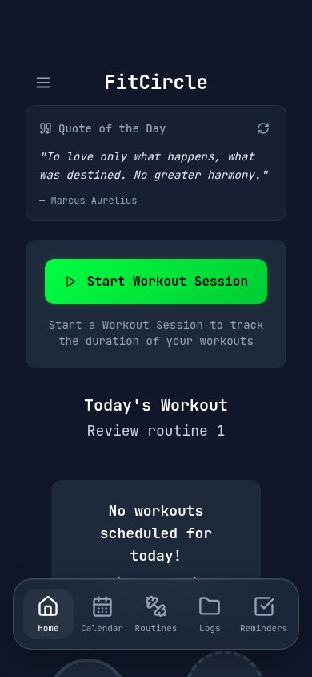 | 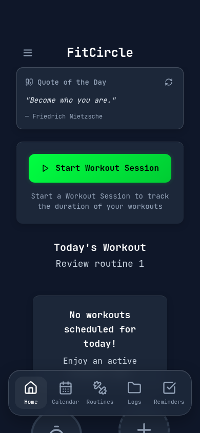 |
| Logs |  | 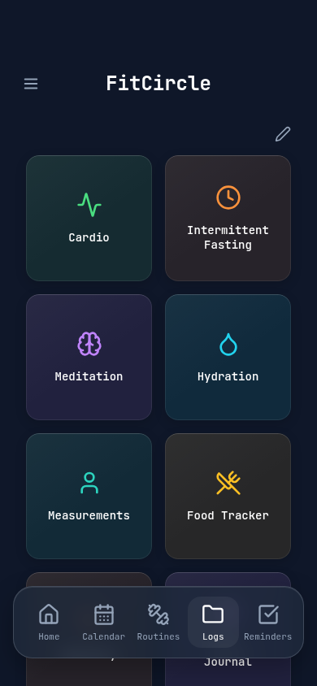 |
| Routines | 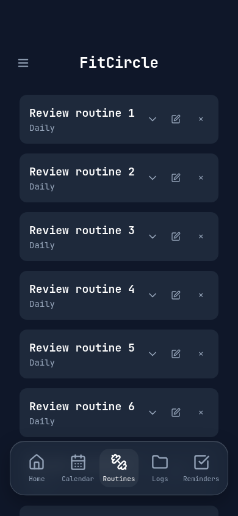 | 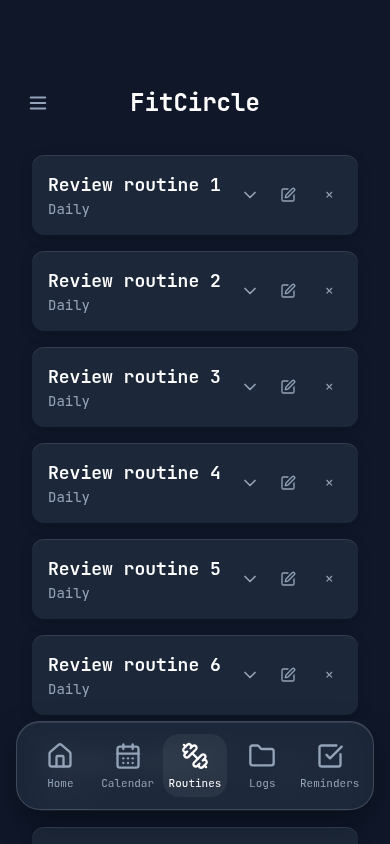 |
| Calendar | 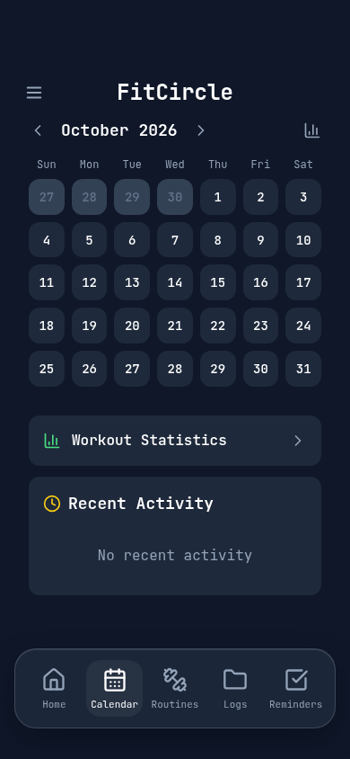 | 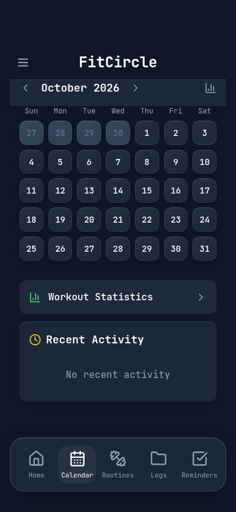 |
| Reminders | 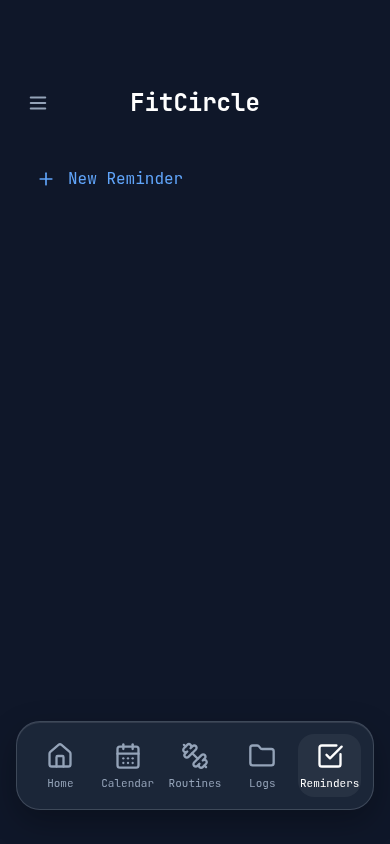 |  |
| Sidebar | 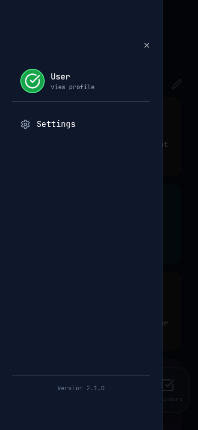 | 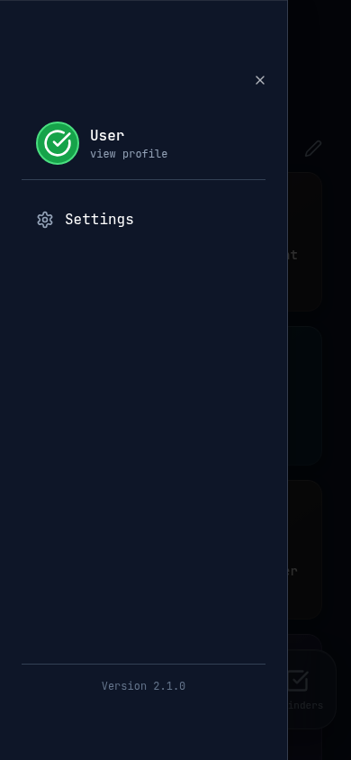 |
| Food Tracker | 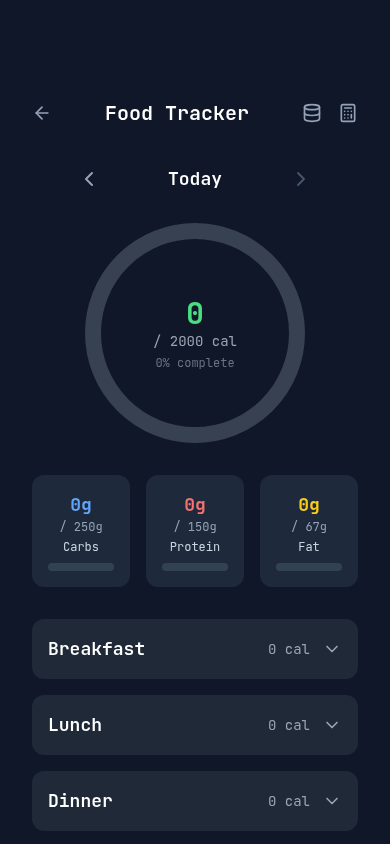 | 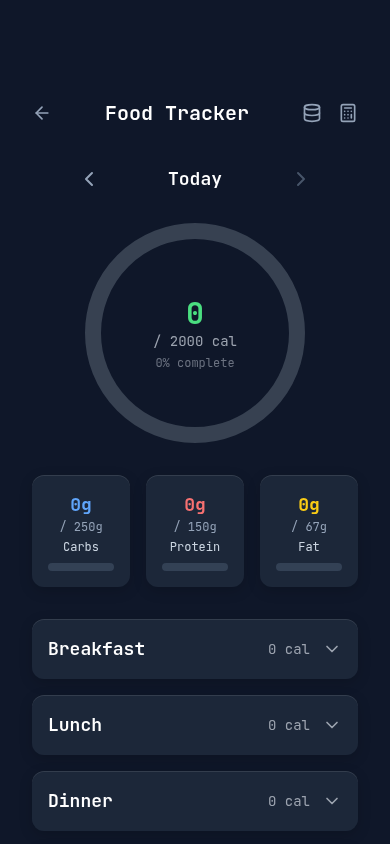 |
| Calculator |  | 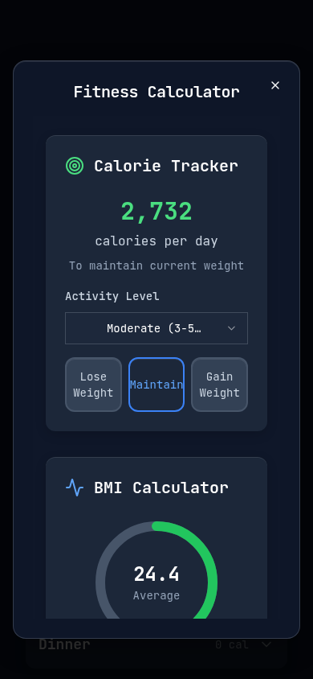 |
| Edit Routine dialog | 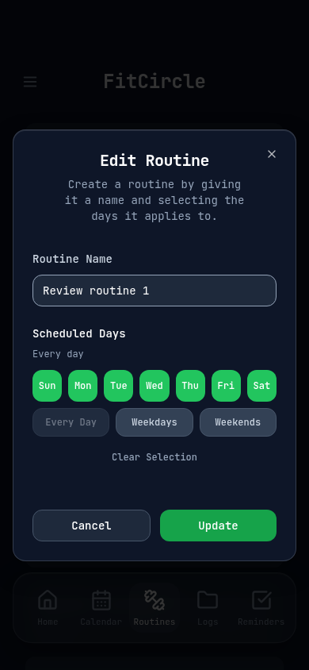 | 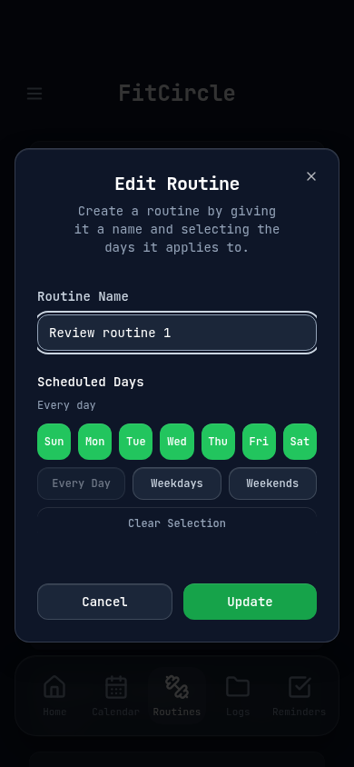 |

These are review artifacts, not automated pixel-diff assertions. Dynamic quote and
calendar content may differ between captures. Browser tests assert real geometry,
category colors, material fallbacks and interaction/persistence behavior.

## Verification and limits

- TypeScript: passed.
- Unit tests:29 passed.
- Production build: passed with existing chunk-size warning.
- Playwright:35 passed, including small/large iPhone sizes, landscape, desktop,
  continuous scrolling surface, compact dock, final-card reachability, safe header,
  sidebar, calculator, keyboard, locks, offline, backup and existing fitness workflows.
- Additional adoption tests preserve category colors/two columns/editing routes,
  reminder creation/completion/reload and calculator values across closing.
- Sequential headless Chromium 120-frame samples of main and this branch, with
  the dock visible, both recorded stable dock geometry, one filtered surface,
  no long tasks, ~16.67ms mean and ~16.8ms maximum frame gaps. Raw samples are
  [before](scroll-sample-before.json) and [after](scroll-sample-after.json).
  Run `node scripts/measure-scroll-review.mjs` against each production preview
  (`REVIEW_BASE_URL` and optional Chromium executable override as in stage 1).
  These short diagnostic samples cannot establish physical device performance.

Physical iPhone 16/iOS 26 Safari and standalone paint/performance acceptance remains
pending, including the original clipping defect that could not be reproduced in
Chromium. Android Chrome, desktop Safari and Firefox were not run. Unsupported-blur
and reduced-transparency/motion paths were simulated in Chromium; they are not
substitutes for those engines. Full manual feature testing is not claimed.

The read-only probe and device checklist in stage 1 are still required before
claiming the persistent physical viewport issue resolved. Do not clear user data
to test updates. No PR is merged automatically.
