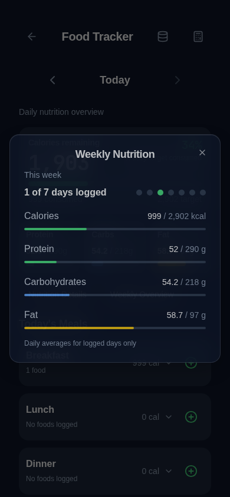

# Weekly Nutrition refinement

## Audit and behavior

The previous modal used a rolling seven days ending on the diary date, stacked each metric over its target and percentage, and displayed an oversized logged-day count. Calendar uses Sunday-first weeks (`calendar-new.tsx`).

| Case | Before | After |
| --- | --- | --- |
| Tuesday diary date | Previous Wednesday–Tuesday | Sunday–Saturday containing selected diary date |
| One logged day, 999 kcal | 999 kcal average | 999 / saved target kcal, thin progress bar |
| Three days: 2,000 + 2,500 + 1,500 kcal | Logged-day average | 2,000 kcal; denominator remains three |
| No logged days | Repeated empty messages | One empty state, seven unfilled indicators |
| Intake above target | Separate percentage | Actual number retained, fill capped at 100% |
| Missing/invalid target | No confirmed target message | Intake only, no fabricated target or bar |
| Unreadable daily record | Excluded with warning | Excluded, distinct outlined indicator and one muted explanation |

“This week” means the local Sunday–Saturday week containing today. Selecting a historical diary date shows its own complete calendar week and date range. All seven dates are read; only dates with actual readable nonempty food records count. A genuinely saved future-dated entry within that selected week counts; empty future dates do not. No missing day is treated as zero intake. Explicit zero-calorie entries still count as logged days. Date iteration uses local noon and calendar-day increments, including DST and year boundaries.

The footer states “Daily averages for logged days only”. Existing per-food serving scaling and nutrient completeness are preserved. A single partial-data disclosure remains available if required; an entirely unknown nutrient average is unavailable, not zero. Bars use the existing Food Tracker macro colors and the shared Nutrition Details bar component. No saved value is clamped or changed.

## Targets and data safety

Target ownership is unchanged: Food Tracker currently receives explicitly saved Fitness Calculator calorie/macro targets. The archived `fitcircle_nutrition_goals` record remains untouched and is not reactivated as a competing goal source. Opening this modal never applies recommendations or writes targets.

No storage keys, schemas, food records, meal grouping, barcode behavior, backup payloads, or import/export logic changed. Tests verify raw stored food/target bytes remain unchanged; existing full backup regressions remain part of the suite. Unreadable data is never repaired or overwritten.

## Validation

- Application TypeScript and regression-test TypeScript: passed.
- Unit tests: 279 passed.
- Nutrition unit tests also run with `TZ=America/New_York` for local calendar/DST boundaries.
- Storage audit: 158 call sites, 0 errors.
- Production build: passed (existing Browserslist/chunk-size advisories).
- Focused Weekly Nutrition + Nutrition Details browser checks: initially 16 passed; two additional weekly cases included in full suite below.
- Full browser suite: **240 passed**, including all 12 weekly cases and the existing backup/offline-history regressions.
- Updated dashboard/offline-history assertion also passed independently.

## Limits / manual verification

Chromium tests cover iPhone-sized 390px and 320px viewports, enlarged root text, wrapping, scrolling, accessible close controls, targets below/at/above intake, unavailable targets, empty and unreadable days, and historical weeks. This is not physical iPhone Safari/PWA verification. On an iPhone, open Weekly Overview, increase text size, scroll to its footer, close it, then select a historical date and confirm its week and dots. No service-worker or deployment changes are included.
