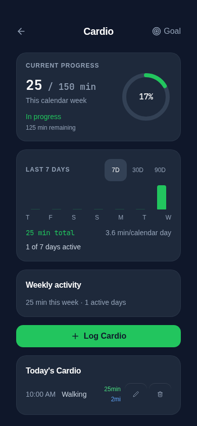
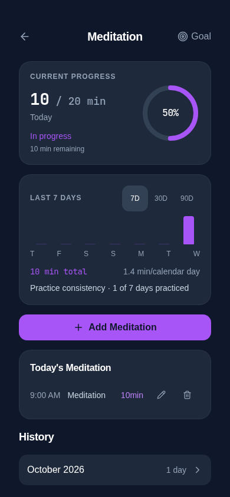
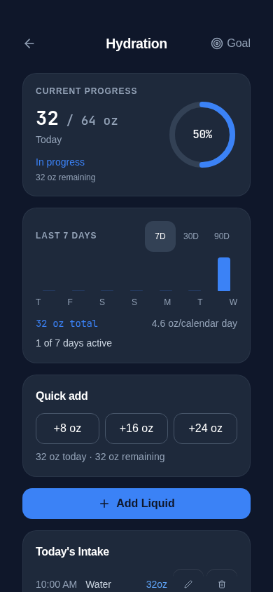
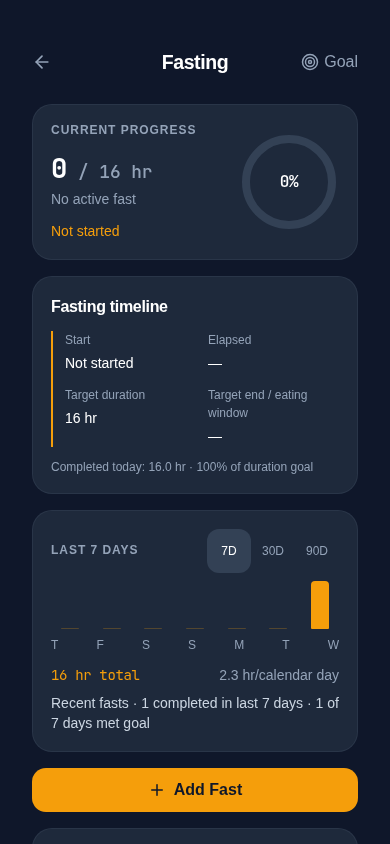

# Wellness 2.0 design implementation

Source: the supplied **FitCircle Wellness 2.0 Design Brief**, all eight PDF pages, including the four directional mockups. Built from main after PR #61 merged. The mockups specify hierarchy and interaction rather than pixel-perfect output.

## Scope and implementation

| Brief requirement | Implementation |
| --- | --- |
| One system, four tools | Shared WellnessPageShell, WellnessProgressHero, WellnessRecentActivity, WellnessTodaySection, WellnessPrimaryAction, WellnessHistoryRow and WellnessGoalSheet in components/wellness/WellnessUI.tsx. Existing feature hooks and forms remain in place. |
| Compact current progress | Numerator/target, period, status, remaining amount and a 100px ring replace the 240px idle ring. Navy/slate surfaces, system labels, tabular metric numerals, original green/amber/purple/blue accents. |
| Cardio | Saved daily/weekly target drives the hero; recent bars show actual session duration or distance. Weekly activity uses the local Sunday calendar week and active-day counts. Logging retains type, duration, distance, notes and custom types. |
| Fasting | Inactive hero never shows old completed records as active. Inactive timeline distinguishes start, elapsed, duration target and unavailable end/eating-window information. Completed-today duration achievement is separate; completed rows expose actual start/end dates and times. Recent bars use completed hours on end dates; counts and days meeting the configured target change with the selected window. Existing historical heat bars remain secondary. |
| Meditation | Today's actual minutes and configured daily goal, recent practice consistency, existing start/pause/resume/stop timer, plus manual completed-session logging through the same validated writer. Existing 20-minute default remains unified with shared Goals. |
| Hydration | Today's valid intake and remaining ounces, +8/+16/+24 oz water shortcuts; customize their amounts inside the existing Add Liquid dialog. Beverage/custom-type logging remains. Targets above 128 oz receive a review reminder without being reset or capped; this is a UI review threshold, not a medical recommendation. |
| 7D / 30D / 90D | Exactly 7/30/90 local calendar dates ending today, real daily bars, totals, calendar-day averages including inactive days, and explicit activity/consistency counts. Daily values also have an accessible table; bars have date/value titles. No elapsed-time rolling averages or future-day activity. |
| Monthly history | Shared compact controlled accordion triggers show actual day/fast counts. Existing monthly/day expansion remains; original detailed records remain browseable. Hydration, cardio and meditation expose historical edit/delete controls using existing validated hooks; fasting retains its edit/delete dialog. |
| Current before historical | Current hero, recent context, quick actions and today/status sections precede monthly history. Existing all-time analytics remain in a quiet disclosure at the bottom or the fasting goal sheet. |
| Accessibility / PWA | 44px header, window, edit/delete and shortcut targets; 48px CTA; wrapping rows, labelled controls, focus rings and reduced-motion ring/caret transitions. Existing shell owns safe-area and dock clearance; logging actions are in normal document flow, not a new overlay. No PWA configuration changes. |

## Before / after behavior

| Before | After |
| --- | --- |
| Tall isolated circle followed by a ten-day summary with considerable vertical space | Compact current-progress card, selectable recent context, consistent action placement and slimmer history |
| Hydration shortcuts were only inside a dialog | Three one-tap water shortcuts on the page, detailed beverage form retained |
| Meditation entry started a timer only | Timer retained, with a direct way to log already-completed practice |
| Completed fasting achievement occupied the primary circle | Primary circle honestly shows no active fast; completed-today achievement and recent consistency are explicitly separate |
| History controls and spacing differed among features | Common month rows and accessible record actions, original forms and records retained |

The daily/weekly math corrections already merged in PR #61 are reused, not reimplemented. A weekly 150-minute target stays 150 minutes, 75 minutes yields 50%; today's hydration/meditation with no valid current records is 0%. A completed 16-hour fast against 16 hours is 100% completed-fast achievement, while the inactive hero stays 0%.

## Preservation and compatibility

- No storage keys, formats, migrations, backup schemas, goals, defaults, dependencies, service workers or deployment settings changed.
- New activity helpers are read-only projections of the same validated hook records. Browsing, selecting windows, opening goals and reloading do not write normalized/default history.
- Shortcut changes are in-memory UI configuration and reset on page remount. No new preference key is introduced.
- Explicit logging/edit/delete continues through existing safe hook writers, including stale-byte and write-failure handling. Historical edits use the selected day and do not affect today's actual records.
- Existing unit fixtures cover legacy records, malformed/unreadable data, calendar boundaries, inactive years, and byte-exact complete backup export/import. New browser tests additionally check stored bytes across UI/window changes.
- Only isolated synthetic records were used in testing and screenshots.

## Existing model limitations

There is **no persisted active-fast model or eating-window setting** in FitCircle's existing fasting records: they describe completed start/end periods. This presentation change does not invent activity, repurpose completed logs or add an incompatible persistence layer. Thus the active timeline intentionally remains inactive and cannot show a genuine live elapsed/target-end/eating-window interval. Actual completed periods are still visible and editable. Adding a persistent start/end-fast workflow would be independent feature work with its own storage/backup design.

The existing meditation timer lifecycle is retained; background suspension, audio and timer restoration behavior are not redesigned here. This change does not prescribe health-specific hydration or fasting targets.

## Validation

- Application TypeScript: passed (npm run check).
- Regression-test TypeScript: passed (tests/tsconfig.regressions.json).
- Unit/regression tests: **268 passed, 0 failed**.
- Storage audit: **161 call sites, 0 errors**.
- Production build: passed; existing outdated Browserslist data and bundle-size warnings remain.
- Focused wellness UI and goal regressions: **21 passed**, including legacy editing, narrow long-history access, storage failures and unchanged raw bytes.
- Final wellness/viewport pass after the last 44px touch-target CSS refinement: **29 passed**.
- Complete browser suite: **219 passed, 0 failed**.
- Whitespace check: passed.

The first complete browser run exposed an outdated positional selector in the hydration write-failure test after three shortcut number inputs moved into the dialog. It was replaced with the exact existing **Amount (oz)** accessible label; the quota-failure and unchanged-bytes assertions are retained. Diagnostic timing cleanup is not included.

Screenshots below use synthetic records in Chromium at 390 × 844, not a physical iPhone:

| Cardio | Meditation |
| --- | --- |
|  |  |

| Hydration | Fasting |
| --- | --- |
|  |  |

[Shared goal sheet](screenshots/goal-sheet.png).

## Physical iPhone checklist

No physical iPhone Safari/PWA verification is claimed.

1. Open each wellness page in Safari and the installed PWA; verify top/bottom safe areas in portrait and landscape and reach the final historical row above the dock/home indicator.
2. Open goal and logging sheets, bring up/dismiss the keyboard, close them, and confirm background scrolling resumes. Try enlarged system text and long custom beverage/cardio names.
3. Check each recent window, inactive days, midnight rollover and timezone changes after suspension. Weekly targets must retain their saved period.
4. Add water and a custom beverage, edit/delete an older entry, and confirm today's intake does not change. Review an unusually high saved goal without resetting it.
5. Log a completed meditation session; exercise timer start/pause/resume/stop, background suspension and audio separately.
6. Log a fast crossing midnight, verify actual timestamps and completed achievement, edit/delete it, and confirm no active state is inferred.
7. Export a synthetic complete backup, restore it, and check all histories and goals in Files/Safari/PWA offline. Camera and unrelated functionality are outside this change.
